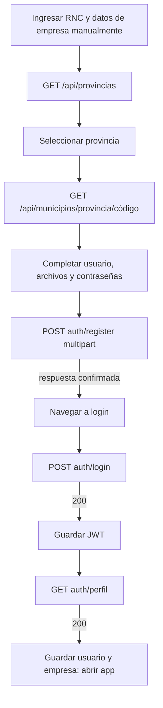
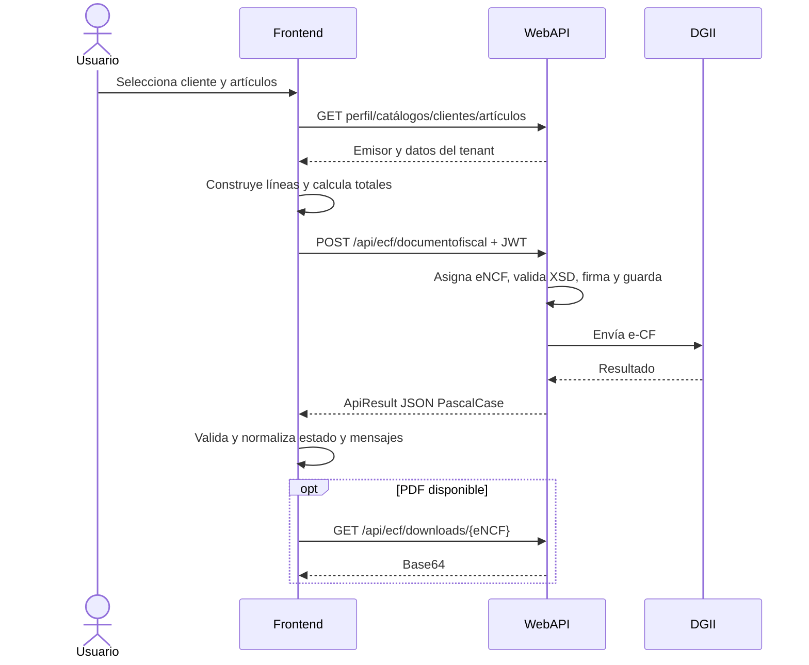

# Guía de integración WebAPI → Frontend

Documento rehecho y verificado contra el código vigente del proyecto **EffisortEmisionEcf** el **10 de agosto de 2026** (`7755091`). Esta es la fuente de verdad para que Codex implemente el frontend; no usar contratos tomados de otros proyectos WebAPI.

Archivos complementarios:

- [`api-types.ts`](./api-types.ts): contratos TypeScript reutilizables.
- [`examples/login.json`](./examples/login.json): login.
- [`examples/perfil-respuesta.json`](./examples/perfil-respuesta.json): usuario y empresa autenticados.
- [`examples/cliente.json`](./examples/cliente.json): alta/edición de cliente.
- [`examples/articulo.json`](./examples/articulo.json): alta/edición de artículo.
- [`examples/ecf-documento.json`](./examples/ecf-documento.json): estructura JSON compacta de emisión e-CF.
- [`examples/facturacion-e31.json`](./examples/facturacion-e31.json): petición completa recomendada para facturación E31.
- [`examples/facturacion-respuesta.json`](./examples/facturacion-respuesta.json): respuesta JSON exitosa de facturación.
- [`examples/requests.http`](./examples/requests.http): llamadas ejecutables con REST Client.

## 1. Reglas globales

| Concepto | Comportamiento actual |
|---|---|
| Base URL local HTTP | `http://localhost:5203` |
| Base URL local HTTPS | `https://localhost:7253` |
| Prefijo | `/api` |
| Swagger | `/swagger`, habilitado actualmente en todos los ambientes |
| JSON general | `camelCase` con `System.Text.Json` |
| Excepción de facturación | `/api/ecf/documentofiscal` responde JSON `PascalCase` serializado con Newtonsoft.Json |
| Autenticación | JWT Bearer |
| Vida del JWT | 2 horas |
| Tenant | Claim JWT `Tenant_ID` |
| Validación JWT | Firma, expiración, issuer y audience |
| Rate limit | 300 solicitudes por IP durante 2 minutos |
| CORS | Cualquier origen/header, pero sólo métodos `GET` y `POST` |
| Excluido del build | `DgiiController.cs` y `Controllers/ECF/**` |

### 1.1 Tipos de respuesta

La API no tiene un sobre uniforme:

- JSON para auth, catálogos, clientes, artículos, empresas y documentos.
- `ProblemDetails` JSON en conflictos de clientes/artículos.
- `ValidationProblemDetails` JSON en validaciones automáticas.
- Texto plano en muchos éxitos y errores.
- JSON `PascalCase` en la emisión `/api/ecf/documentofiscal`.
- XML en consulta de TrackId, recepción e-CF y otros procesos XML.
- Base64 como texto para descarga de PDF.
- Cuerpo vacío en `204`, algunos `200`, `401`, `403` y `404`.

No llamar siempre `response.json()`. El adaptador debe leer primero texto y decidir por `Content-Type`.

```ts
export async function parseApiResponse(response: Response): Promise<unknown> {
  const text = await response.text();
  if (!text) return undefined;

  const contentType = response.headers.get("content-type") ?? "";
  if (contentType.includes("json")) {
    try {
      return JSON.parse(text);
    } catch {
      return text;
    }
  }

  return text;
}
```

### 1.2 Autorización

Existen cuatro niveles efectivos:

| Nivel | Rutas |
|---|---|
| Público explícito | Auth excepto `/perfil`, catálogos y endpoints de roles |
| JWT, cualquier usuario | Clientes, artículos, documentos fiscales y TokenInspector |
| JWT + rol exacto `SUPERADMIN` | Sólo `GET /api/empresas` |
| JWT efectivo por comprobación manual | `/api/auth/perfil` y `/api/ecf/*`, aunque no declaren `[Authorize]` |
| Público por falta de atributo | Empresa por ID/RNC y administración de roles |

Header:

```http
Authorization: Bearer eyJ...
```

Claims relevantes:

- Email.
- Nombre/display name.
- Rol: puede aparecer como `role` o URI de claims Microsoft al decodificar.
- `Tenant_ID`: GUID del tenant.
- `exp`: expiración Unix del token.
- `iss` y `aud`: deben coincidir con `JwtSettings` del backend.

Cada rol se emite ahora como un claim `role` independiente. Ya no se concatenan varios roles en una sola cadena.

No existe refresh token ni endpoint de logout.

### 1.3 Restricción CORS que afecta al frontend

El backend sólo permite `GET` y `POST` en CORS. Los nuevos endpoints de clientes y artículos también usan `PUT` y `DELETE`.

Consecuencia:

- Mismo origen o proxy de desarrollo: pueden funcionar.
- Frontend en otro origen: el navegador bloqueará `PUT` y `DELETE` en el preflight hasta ampliar CORS.

Codex debe implementar esas operaciones normalmente, pero documentar el bloqueo en el entorno de integración; no sustituirlas por métodos distintos.

## 2. Índice completo de endpoints

### 2.1 Auth

| Método | Ruta | Seguridad | Entrada | Salida principal |
|---|---|---|---|---|
| POST | `/api/auth/login` | Pública | JSON | `{ token }` |
| GET | `/api/auth/perfil` | JWT efectivo | Sin body | Usuario y empresa en JSON |
| POST | `/api/auth/register` | Pública | `multipart/form-data` | Contrato inestable: el controlador devuelve `Ok(Task)` |
| POST | `/api/auth/forgot-password` | Pública | JSON | Texto |
| POST | `/api/auth/reset-password` | Pública | JSON | Texto |

### 2.2 Clientes

Todas requieren JWT y se filtran por el tenant del token.

| Método | Ruta | Uso |
|---|---|---|
| GET | `/api/clientes?incluirInactivos=false` | Listado |
| GET | `/api/clientes/{id}` | Detalle por GUID |
| GET | `/api/clientes/rnc/{rnc}` | Detalle por RNC |
| POST | `/api/clientes` | Crear |
| PUT | `/api/clientes/{id}` | Reemplazar campos editables |
| DELETE | `/api/clientes/{id}` | Baja lógica |

### 2.3 Artículos

Todas requieren JWT y se filtran por el tenant del token.

| Método | Ruta | Uso |
|---|---|---|
| GET | `/api/articulos?incluirInactivos=false` | Listado |
| GET | `/api/articulos/{id}` | Detalle por GUID |
| GET | `/api/articulos/codigo/{codigo}` | Detalle por código |
| POST | `/api/articulos` | Crear |
| PUT | `/api/articulos/{id}` | Reemplazar campos editables |
| DELETE | `/api/articulos/{id}` | Baja lógica |

### 2.4 Catálogos públicos

| Recurso | Listado | Detalle |
|---|---|---|
| Formas de pago | `GET /api/formaspago` | `GET /api/formaspago/{id}` |
| Indicadores facturación | `GET /api/indicadoresfacturacion` | `GET /api/indicadoresfacturacion/{id}` |
| Indicadores retención | `GET /api/indicadoresretencion` | `GET /api/indicadoresretencion/{id}` |
| Medidas | `GET /api/medidas` | `GET /api/medidas/{id}` |
| Monedas | `GET /api/monedas` | `GET /api/monedas/{id}` |
| Países | `GET /api/paises` | `GET /api/paises/{id}` |
| Términos de pago | `GET /api/terminospagos` | `GET /api/terminospagos/{id}` |
| Tipos de ajuste | `GET /api/tiposajustes` | `GET /api/tiposajustes/{id}` |
| Tipos de comprobante | `GET /api/tiposcomprobantes` | `GET /api/tiposcomprobantes/{id}` |
| Impuestos adicionales | `GET /api/tiposimpuestosadicionales` | `GET /api/tiposimpuestosadicionales/{id}` |
| Tipos de ingreso | `GET /api/tiposingresos` | `GET /api/tiposingresos/{id}` |
| Tipos de modificación | `GET /api/tiposmodificaciones` | `GET /api/tiposmodificaciones/{id}` |
| Tipos de pago | `GET /api/tipospagos` | `GET /api/tipospagos/{id}` |
| Provincias | `GET /api/provincias` | No existe |
| Municipios | `GET /api/municipios` | `GET /api/municipios/provincia/{codigo}` |

### 2.5 DGII (no disponible en el build actual)

`webapi.csproj` excluye `Controllers/DgiiController.cs` mediante `<Compile Remove>`. Las rutas siguientes existen solamente en el archivo fuente: la aplicación compilada responde `404` y Swagger no las muestra.

| Método | Ruta | Estado actual |
|---|---|---|
| GET | `/api/dgii/consulta-rnc?rnc=...` | No registrada; `404` |
| GET | `/api/dgii/consulta-provincias` | No registrada; `404` |
| GET | `/api/dgii/consulta-municipios?provincia=...` | No registrada; `404` |
| POST | `/api/dgii/upload-provincias-csv` | No registrada; `404` |
| POST | `/api/dgii/upload-municipios-csv` | No registrada; `404` |
| POST | `/api/dgii/upload-rnc-zip` | No registrada; `404` |
| POST | `/api/dgii/split-excel-xml` | No registrada; `404` |

### 2.6 Empresas y documentos fiscales

| Método | Ruta | Seguridad |
|---|---|---|
| GET | `/api/empresas` | Rol `SUPERADMIN` |
| GET | `/api/empresas/{id}` | Pública actualmente |
| GET | `/api/empresas/rnc/{rnc}` | Pública actualmente |
| GET | `/api/documentosfiscales/search` | JWT + tenant automático |
| GET | `/api/documentosfiscales` | JWT; consulta global actualmente |
| GET | `/api/documentosfiscales/{id}` | JWT; consulta global actualmente |
| GET | `/api/documentosfiscales/comprador/{rnc}` | JWT; consulta global actualmente |

### 2.7 e-CF

| Método | Ruta | Entrada/salida |
|---|---|---|
| POST | `/api/ecf/documentofiscal` | JSON `camelCase` → JSON `PascalCase` (`ApiResult`) |
| POST | `/api/ecf/consultartrackid?trackId=...` | Query → XML |
| GET | `/api/ecf/downloads/{numero}` | Base64 texto |
| POST | `/api/ecf/ecf` | XML multipart → XML ARECF |
| POST | `/api/ecf/emision-aprobacion-comercial` | JSON → vacío |
| POST | `/api/ecf/generar-pdf` | JSON → texto |

### 2.8 Roles e inspección JWT

| Método | Ruta | Seguridad |
|---|---|---|
| POST | `/api/roles/create` | Pública actualmente |
| POST | `/api/roles/assign?userId=...&roleName=...` | Pública actualmente |
| POST | `/api/roles/remove?userId=...&roleName=...` | Pública actualmente |
| GET | `/api/roles/user/{userId}/roles` | Pública actualmente |
| GET | `/api/roles/list` | Pública actualmente |
| DELETE | `/api/roles/delete/{roleName}` | Pública actualmente |
| GET | `/api/tokeninspector/claims` | JWT |
| GET | `/api/tokeninspector/check-auth` | JWT |

### 2.9 Controladores excluidos

- `POST /api/emision/EmisionComprobantes` sólo existe en `Controllers/ECF/EmisionController.cs`.
- `POST /api/recepcion/fe/RecepcionComprobantes` sólo existe en `Controllers/ECF/RecepcionController.cs`.

La carpeta completa `Controllers/ECF/**` está excluida por `webapi.csproj`. Ninguna de estas rutas se registra, ambas devuelven `404` y no deben formar parte de la integración. Esto no afecta a `Controllers/EcfController.cs`, que sí contiene las rutas activas `/api/ecf/*` documentadas arriba.

## 3. Autenticación y registro

### 3.1 Login

`POST /api/auth/login`

```json
{
  "email": "admin@empresa.com",
  "password": "Secreto123"
}
```

Validación:

- `email`: requerido y formato email.
- `password`: requerido.
- El login ya no solicita RNC.

Éxito `200 application/json`:

```json
{
  "token": "eyJhbGciOiJIUzI1NiIs..."
}
```

Errores `401`, texto:

```text
Usuario no encontrado
```

o:

```text
Credenciales inválidas
```

El frontend debe descartar sesiones cuyo JWT no tenga `Tenant_ID`, porque clientes, artículos y e-CF dependen de él. Después del login debe consultar el perfil para cargar el usuario y la empresa vigente.

### 3.2 Perfil autenticado

`GET /api/auth/perfil`

```http
GET /api/auth/perfil
Authorization: Bearer <token>
Accept: application/json
```

No recibe body ni parámetros. En éxito devuelve `200 application/json` en camelCase:

```json
{
  "id": "c88c7491-9875-4bc2-8977-23c932b98242",
  "userName": "oceanadmin",
  "email": "admin@empresa.com",
  "phoneNumber": "8095550101",
  "empresa": {
    "tenantId": "8ec759e0-0658-4be7-84e2-390658d90f85",
    "nombreRazonSocial": "EMPRESA EJEMPLO SRL",
    "nombreComercial": "EMPRESA EJEMPLO",
    "sucursal": null,
    "rnc": "101234567",
    "direccion": "AV. EJEMPLO NO. 123, SANTO DOMINGO",
    "telefono": "8095550100",
    "telefono2": null,
    "municipioId": "010100",
    "provinciaId": "010000",
    "correo": "facturacion@empresa-ejemplo.com",
    "webSite": null,
    "actividadEconomica": "SERVICIOS DE CONSULTORIA"
  }
}
```

Este es el endpoint que debe utilizar el frontend para conocer la empresa del usuario autenticado. Devuelve un subconjunto seguro de la empresa y no expone certificado, contraseña de certificado, credenciales SMTP ni otras configuraciones internas.

Seguridad efectiva: la acción no tiene `[Authorize]`, pero intenta resolver al usuario desde los claims mediante `UserManager`. Sin una identidad válida devuelve:

```json
{ "mensaje": "Usuario no autenticado" }
```

con estado `401`. Si no localiza el usuario o su empresa, devuelve `404` JSON con `{ "mensaje": "Usuario no encontrado" }` o `{ "mensaje": "Empresa no encontrado" }`.

Las propiedades string del DTO no están declaradas como nullable, pero varias fuentes de Identity/Empresa sí pueden contener `null`; los tipos frontend las modelan como `string | null`.

Flujo recomendado:

1. Guardar el JWT después de `POST /api/auth/login`.
2. Ejecutar una sola vez `GET /api/auth/perfil` al iniciar/restaurar la sesión.
3. Guardar `UsuarioPerfil` en el store de sesión.
4. Usar `perfil.empresa` como fuente para los datos base del emisor y para mostrar la organización activa.
5. En `401`, invalidar la sesión; en `404`, mantener la sesión sólo para mostrar un error de configuración y bloquear la facturación.

### 3.3 Registro

`POST /api/auth/register`

La entrada es **`multipart/form-data`**, no JSON. Nombres exactos:

| Campo | Obligatorio | Regla |
|---|---:|---|
| `Rnc` | Sí | Máximo 11 |
| `RazonSocial` | Sí | Máximo 80 |
| `ActividadEconomica` | Sí | Máximo 100 |
| `ProvinciaId` | Sí | Exactamente 6 |
| `MunicipioId` | Sí | Exactamente 6 |
| `FullName` | Sí | El controlador actualmente no lo usa |
| `PhoneNumber` | Sí | Sin validación de formato |
| `UserName` | Sí | Mínimo 6 |
| `Email` | Sí | Formato email |
| `ConfirmEmail` | Sí | Formato email; backend no compara igualdad |
| `Password` | Sí | Mínimo 6 |
| `ConfirmPassword` | Sí | Mínimo 6 y debe coincidir |
| `LogoEmpresa` | No | PNG esperado |
| `CertificadoFirmaDigital` | No | P12, MIME `application/x-pkcs12` esperado |
| `PasswordCertificadoFirmaDigital` | No | Texto |

Ejemplo:

```ts
const form = new FormData();
form.append("Rnc", values.rnc);
form.append("RazonSocial", values.razonSocial);
form.append("ActividadEconomica", values.actividadEconomica);
form.append("ProvinciaId", values.provinciaId);
form.append("MunicipioId", values.municipioId);
form.append("FullName", values.fullName);
form.append("PhoneNumber", values.phoneNumber);
form.append("UserName", values.userName);
form.append("Email", values.email);
form.append("ConfirmEmail", values.confirmEmail);
form.append("Password", values.password);
form.append("ConfirmPassword", values.confirmPassword);
form.append("PasswordCertificadoFirmaDigital", values.passwordCertificado ?? "");
if (values.logo) form.append("LogoEmpresa", values.logo);
if (values.certificado) form.append("CertificadoFirmaDigital", values.certificado);

await fetch(`${API_URL}/api/auth/register`, {
  method: "POST",
  body: form,
});
```

No establecer manualmente `Content-Type`; el navegador debe incluir el boundary.

El resultado de negocio que intenta producir el servicio es:

```json
{
  "id": "c88c7491-9875-4bc2-8977-23c932b98242",
  "userName": "oceanadmin",
  "email": "admin@empresa.com",
  "password": "Secreto123",
  "message": "Empresa registrada exitosamente"
}
```

Sin embargo, el controlador actual hace `Ok(_authService.Registrar(model))` sin `await`: envuelve un `Task` dentro de la respuesta. Por eso el payload HTTP real no debe considerarse estable; puede serializar metadatos del task o fallar durante la serialización. El frontend no debe cerrar el flujo de registro basándose en la forma anterior hasta corregir ese `await`.

Si llega a recibirse el resultado pretendido, expone `password`. El frontend debe ignorar esa propiedad, no registrarla y no persistirla.

Errores frecuentes `400` texto:

- Email o username ya usados.
- Empresa ya registrada.
- Contraseñas distintas.
- Rol por defecto ausente.
- Errores de modelo, generalmente `ValidationProblemDetails`.

El registro no devuelve JWT. Después de `200`, navegar al login.

### 3.4 Recuperación

`POST /api/auth/forgot-password`

```json
{
  "email": "admin@empresa.com"
}
```

Éxito: `200` texto `Correo enviado para restablecer contraseña`. Usuario inexistente: `400` texto `Usuario no encontrado`. El token se crea con expiración de 2 horas y el enlace apunta a:

```text
https://effisort.com/reset-password?token=...
```

`POST /api/auth/reset-password`

```json
{
  "email": "admin@empresa.com",
  "resetCode": "token-del-enlace",
  "newPassword": "NuevaClave123"
}
```

El backend consulta `resetCode` y no contrasta `email`. Token inválido/expirado: `400` texto. Éxito: `200` texto.

Advertencia: el reset escribe un hash BCrypt, mientras el login actual valida con `PasswordHasher<ApplicationUser>`. Una contraseña restablecida puede no ser aceptada por login hasta corregir esa incompatibilidad.

Además, el usuario de Identity tiene clave primaria `string`, pero el servicio de reset intenta localizarlo pasando un `Guid`. El flujo debe considerarse no operativo hasta comprobar/corregir ambos puntos.

## 4. Clientes

Modelo: `Cliente` en `api-types.ts`.

Validaciones relevantes:

| Campo | Obligatorio | Máximo/formato |
|---|---:|---|
| `razonSocialComprador` | Sí | 150 |
| `rncComprador` | No | 11 |
| `identificadorExtranjero` | No | 20 |
| `contactoComprador` | No | 80 |
| `correoComprador` | No | Email, 80 |
| `direccionComprador` | No | 100 |
| `municipioComprador` | No | 10 |
| `provinciaComprador` | No | 10 |
| `paisComprador` | No | 60 |
| `fechaEntrega` | No | String, 10 |
| `contactoEntrega` / `direccionEntrega` | No | 100 |
| `telefonoAdicional` | No | 12 |
| `codigoInternoComprador` | No | 20 |
| `responsablePago` | No | 20 |
| `informacionAdicionalComprador` | No | 150 |
| `activo` | Sí | Boolean |

### 4.1 Listado

```http
GET /api/clientes
GET /api/clientes?incluirInactivos=true
Authorization: Bearer <token>
```

- Default: sólo `activo=true`.
- Orden: `razonSocialComprador`.
- Respuesta: `200 Cliente[]`; vacío es `[]`.

### 4.2 Consultas

- `GET /api/clientes/{guid}`
- `GET /api/clientes/rnc/{rnc}`

Devuelven `200 Cliente` o `404` vacío. RNC y código interno se guardan con espacios extremos eliminados.

### 4.3 Crear

`POST /api/clientes`

```json
{
  "rncComprador": "131234567",
  "identificadorExtranjero": null,
  "razonSocialComprador": "Cliente Ejemplo SRL",
  "contactoComprador": "María Pérez",
  "correoComprador": "compras@cliente.com",
  "direccionComprador": "Av. Principal 123",
  "municipioComprador": "010101",
  "provinciaComprador": "010000",
  "paisComprador": "DO",
  "fechaEntrega": null,
  "contactoEntrega": "Almacén",
  "direccionEntrega": "Av. Principal 123",
  "telefonoAdicional": "8095550101",
  "codigoInternoComprador": "CLI-0001",
  "responsablePago": "María Pérez",
  "informacionAdicionalComprador": null,
  "tipoPrecio": 1,
  "tipoPago": 1,
  "terminoPago": 30,
  "activo": true
}
```

El servidor sobrescribe `id` y `tenantId`; se recomienda no enviarlos al crear. Los campos `ultimaFecha`, `ultimoUsuario` y `cuentaContable` ya no existen en el modelo actual.

Éxito: `201 Cliente` y header `Location`. Conflicto de RNC o código interno dentro del mismo tenant: `409 application/problem+json`.

```json
{
  "title": "No se pudo crear el cliente.",
  "status": 409,
  "detail": "Ya existe un cliente con el RNC '131234567'."
}
```

### 4.4 Actualizar

`PUT /api/clientes/{id}`

Enviar todos los campos editables, no sólo los modificados: el servicio reemplaza cada propiedad con el body.

- `200 Cliente`: actualizado.
- `404`: no existe en el tenant.
- `409 ProblemDetails`: RNC o código interno duplicado.

### 4.5 Eliminar/reactivar

`DELETE /api/clientes/{id}` realiza baja lógica:

- Cambia `activo=false`.
- `204` sin cuerpo si existe.
- `404` si no existe en el tenant.

Para reactivar, listar con `incluirInactivos=true` y hacer `PUT` del objeto completo con `activo=true`.

## 5. Artículos

Modelo: `Articulo` en `api-types.ts`.

Validaciones relevantes:

| Campo | Obligatorio | Máximo/formato |
|---|---:|---|
| `codigo` | No | 35, único por tenant si existe |
| `tipoCodigo` | No | 14 |
| `indicadorFacturacion` | Sí | Entero |
| `nombreItem` | Sí | 80 |
| `indicadorBienoServicio` | Sí | Entero |
| `descripcionItem` | No | 1000 |
| `unidadMedida` | Sí | Entero |
| `precioUnitarioItem` | Sí | Decimal |
| `existencia` | Sí | Decimal |
| `codigoImpuesto` | No | 100 |
| `activo` | Sí | Boolean |

### 5.1 Listado y consultas

```http
GET /api/articulos
GET /api/articulos?incluirInactivos=true
GET /api/articulos/{guid}
GET /api/articulos/codigo/{codigo}
```

- Listado default: activos.
- Orden: `nombreItem`.
- Detalle ausente: `404` vacío.

### 5.2 Crear

`POST /api/articulos`

```json
{
  "codigo": "ART-0001",
  "tipoCodigo": "INT",
  "indicadorFacturacion": 1,
  "nombreItem": "Servicio de consultoría",
  "indicadorBienoServicio": 2,
  "descripcionItem": "Consultoría mensual",
  "unidadMedida": 43,
  "precioUnitarioItem": 1500.00,
  "existencia": 0,
  "codigoImpuesto": "ITBIS18",
  "cantidadReferencia": null,
  "unidadReferencia": null,
  "gradosAlcohol": null,
  "precioUnitarioReferencia": null,
  "activo": true
}
```

El servidor sobrescribe tenant e ID. Código vacío/espacios se convierte en `null`. Código repetido en el tenant: `409 ProblemDetails`. Éxito: `201 Articulo`. Los campos `ultimaFecha` y `ultimoUsuario` ya no existen.

### 5.3 Actualizar y eliminar

`PUT /api/articulos/{id}` reemplaza los campos editables y devuelve `200`, `404` o `409`.

`DELETE /api/articulos/{id}` hace baja lógica y devuelve `204` o `404`. Reactivar con `PUT activo=true`.

Los campos numéricos no-null (`indicadorFacturacion`, `indicadorBienoServicio`, `unidadMedida`, `precioUnitarioItem`, `existencia`) deben validarse en cliente; si se omiten pueden enlazarse como `0`, aunque sea fiscalmente inválido.

## 6. Catálogos

Todos son públicos, no paginados y actualmente no filtran por tenant.

| Tipo TypeScript | Forma JSON |
|---|---|
| `FormaPago` | `{ id, tenantId, codigo, descripcion, activo }` |
| `IndicadorFacturacion` | `{ id, tenantId, codigo, descripcion, tasaItbis, activo }` |
| `IndicadorRetencion` | `{ id, tenantId, codigo, nombre, activo }` |
| `Medida` | `{ id, tenantId, codigo, abreviatura, medidaNombre, activo }` |
| `Moneda` | `{ id, tenantId, codigo, descripcion, activo }` |
| `Pais` | `{ id, tenantId, codigo, nombre, activo }` |
| `Provincia` | `{ id, tenantId, codigo, nombre, activo }` |
| `Municipio` | `{ id, tenantId, codigo, nombre, provinciaCodigo, activo }` |
| `TerminoPago` | `{ id, tenantId, codigo, nombre, activo }` |
| `TipoAjuste` | `{ id, tenantId, codigo, nombre, activo }` |
| `TipoComprobante` | `{ id, tenantId, tipo, ecf, activo }` |
| `TipoImpuestoAdicional` | `{ id, tenantId, codigo, tipoImpuesto, abreviatura, descripcion, tasa, tipoMontoPorcentaje, activo }` |
| `TipoIngreso` | `{ id, tenantId, codigo, descripcion, activo }` |
| `TipoModificacion` | `{ id, tenantId, codigo, descripcion, activo }` |
| `TipoPago` | `{ id, tenantId, codigo, nombre, activo }` |

Listados retornan `200 []` si no hay datos. Detalles retornan `404` vacío. Municipios por provincia también retorna `200 []`, porque la consulta nunca produce `null`.

No confundir:

- `/api/provincias` y `/api/municipios`: SQL Server, objetos con GUID/tenant.
- Las antiguas consultas `/api/dgii/consulta-provincias` y `consulta-municipios` apuntan a SQLite en el código fuente, pero el controlador DGII no se compila actualmente.

Para registro se esperan códigos de 6 caracteres, no GUID. En el build actual se deben obtener de `GET /api/provincias` y `GET /api/municipios/provincia/{codigoProvincia}`.

## 7. DGII: contrato fuente no disponible

**No integrar estas rutas como activas.** El proyecto contiene `Controllers/DgiiController.cs`, pero `webapi.csproj` tiene `<Compile Remove="Controllers\DgiiController.cs" />`. En consecuencia, todas responden `404` y no aparecen en Swagger.

Los contratos siguientes se conservan únicamente como referencia para una futura reactivación del controlador.

### 7.1 Consultas definidas en el archivo excluido

`GET /api/dgii/consulta-rnc?rnc=101234567`

```json
{
  "rnc": "101234567",
  "razonSocial": "EMPRESA EJEMPLO SRL",
  "actividadEconomica": "SERVICIOS",
  "fechaInicioOperaciones": "01/01/2020",
  "estado": "ACTIVO",
  "regimenPago": "NORMAL"
}
```

Si el controlador se reactiva, un RNC no encontrado se representa como `404` texto.

`GET /api/dgii/consulta-provincias`

```json
[
  { "codigo": "010000", "nombre": "DISTRITO NACIONAL" }
]
```

`GET /api/dgii/consulta-municipios?provincia=010000`

```json
[
  {
    "codigo": "010101",
    "nombre": "SANTO DOMINGO DE GUZMÁN",
    "provinciaCodigo": "010000"
  }
]
```

Si el controlador se reactiva, sin filas devuelve `404` texto, no arreglo vacío.

### 7.2 Cargas definidas en el archivo excluido

Todas están diseñadas para recibir `multipart/form-data`, campo `file`. Actualmente ninguna ruta está registrada.

| Endpoint | MIME exacto |
|---|---|
| `upload-provincias-csv` | `text/csv` |
| `upload-municipios-csv` | `text/csv` |
| `upload-rnc-zip` | `application/x-zip-compressed` |
| `split-excel-xml` | `application/vnd.openxmlformats-officedocument.spreadsheetml.sheet` |

Si el controlador se reactiva sin otros cambios, quedarían públicas porque su autorización está comentada. El frontend no debe ofrecer la pantalla de carga mientras continúen excluidas.

## 8. Empresas

Para obtener la empresa activa del usuario normal se debe usar `GET /api/auth/perfil`. Esa respuesta toma la empresa asociada al tenant del usuario y excluye secretos. Las rutas `/api/empresas` siguientes quedan como consultas administrativas o heredadas.

Los permisos actuales son distintos por acción:

- `GET /api/empresas`: exige rol exacto `SUPERADMIN`; devuelve todas las empresas sin tenant filter.
- `GET /api/empresas/{guid}`: público actualmente.
- `GET /api/empresas/rnc/{rnc}`: público actualmente.

Las consultas por ID/RNC devuelven `401 Unauthorized` cuando no encuentran la empresa, no `404`.

La respuesta contiene configuración sensible, incluyendo `passwordCertificado` y `emailPassword`. El frontend no debe loguear, persistir ni mostrar esos campos.

## 9. Documentos fiscales

Todas las rutas requieren JWT. El aislamiento por tenant ahora es distinto según la acción: `search` sí aplica el tenant del usuario autenticado cuando `ApplicationUser.TenantId` tiene valor; las otras tres consultas continúan siendo globales.

### 9.1 Búsqueda

`GET /api/documentosfiscales/search`

Query opcional:

- `tenantId` (redundante para un usuario normal; no enviarlo)
- `encfTipo`
- `encf`
- `rncEmisor`
- `rncComprador`
- `idExtranjero`
- `fechaEmision`
- `correoComprador`
- `estadoEncf`
- `pageNumber` default 1
- `pageSize` default 10, máximo 25

Primero se filtra por el `TenantId` del usuario y después se aplican los parámetros. Por tanto, un `tenantId` distinto no permite consultar otro tenant: produce cero resultados. Todos los filtros de texto, incluido `encf`, usan `Contains`; no hay orden definido.

Ejemplo para localizar un comprobante dentro de la empresa autenticada:

```http
GET /api/documentosfiscales/search?encf=E310000000001&pageNumber=1&pageSize=10
Authorization: Bearer <token>
```

```json
{
  "totalItems": 42,
  "pageNumber": 1,
  "pageSize": 10,
  "totalPages": 5,
  "items": []
}
```

No enviar página/tamaño menores de 1.

La protección depende de que el usuario de Identity tenga `TenantId`. El frontend ya debe rechazar una sesión cuyo token traiga `Tenant_ID` vacío o ausente; una cuenta autenticada sin asociación de tenant podría provocar una búsqueda global por el comportamiento actual del controlador.

### 9.2 Otras consultas

- `GET /api/documentosfiscales`: todo, sin paginar y **sin filtro de tenant**.
- `GET /api/documentosfiscales/{id}`: ID entero y **sin filtro de tenant**.
- `GET /api/documentosfiscales/comprador/{rnc}`: sin filtro de tenant; devuelve `404` si no hay filas, no `[]`.

Para la bandeja y las verificaciones de facturación, usar preferentemente `search`. No presentar las otras rutas como consultas seguras de la empresa hasta que el backend les aplique el mismo aislamiento.

Varias fechas del documento son strings no normalizados. Sólo `createdAt` y `updatedAt` son timestamps JSON.

## 10. e-CF

### 10.1 Seguridad efectiva

`EcfController` no declara `[Authorize]`. `ITenantScoped` asigna un GUID reservado al usuario anónimo y cada acción comprueba manualmente si falta tenant.

Tratar todas las rutas `/api/ecf/*` como JWT. Sin token responden `401` con el texto `Tenant information is missing in the JWT token or user not authenticated.`. Incluso `/api/ecf/generar-pdf`, marcado `[AllowAnonymous]`, realiza esta comprobación y exige un tenant válido.

### 10.2 Emitir documento desde JSON

`POST /api/ecf/documentofiscal`

Este es el endpoint de facturación que debe usar el frontend. Recibe el documento fiscal completo como JSON y, en el código actual, devuelve **JSON**, no XML. El contrato de entrada es `EcfRequest`, la respuesta literal es `FacturacionApiResponse` y el modelo normalizado para la UI es `EcfApiResult`, todos disponibles en [`api-types.ts`](./api-types.ts).

Ejemplos:

- [`examples/facturacion-e31.json`](./examples/facturacion-e31.json): petición E31 recomendada.
- [`examples/facturacion-respuesta.json`](./examples/facturacion-respuesta.json): respuesta exitosa.
- [`examples/ecf-documento.json`](./examples/ecf-documento.json): petición compacta heredada.

#### 10.2.1 Petición HTTP

```http
POST /api/ecf/documentofiscal
Authorization: Bearer <jwt>
Content-Type: application/json
Accept: application/json

{ "ecf": { ... } }
```

- El JWT debe ser válido y aportar un `Tenant_ID` utilizable.
- El body no recibe `tenantId`, `userId`, `trackId` ni archivos.
- Usar los nombres JSON como están en los ejemplos. Los casos fáciles de escribir mal son `tipoeCF`, `eNCF`, `itbiS1` y `totalITBIS`.
- Enviar cantidades e importes como números JSON, nunca como strings con moneda o separadores de miles.
- Las fechas fiscales que consume este flujo usan `dd-MM-yyyy`.
- Omitir campos opcionales sin valor; no llenar indiscriminadamente el objeto con `null` o strings vacíos porque el servidor lo convierte a XML y lo valida contra el XSD.

Aunque el backend tiene formatters XML habilitados y Swagger enumera también media types XML para el body, el contrato de integración de esta ruta es petición JSON y respuesta JSON. Como la acción retorna `IActionResult` sin metadatos `ProducesResponseType`, Swagger sólo lista `200` y no describe la forma real de `ApiResult`; para esta respuesta prevalecen el controlador y `FacturacionApiResponse`.

#### 10.2.2 Prerrequisitos

La operación depende de recursos que no vienen en el body:

| Requisito | Responsable | Resultado si falta o es inválido |
|---|---|---|
| JWT con `Tenant_ID` | Frontend/sesión | `401` texto |
| Datos fiscales completos del emisor | Aplicación/configuración | Error de estructura, XSD o procesamiento |
| Secuencia activa para el tipo, por ejemplo `E31` | Backend/operaciones | Error al asignar e-NCF |
| XSD configurado como `XSD_E31`, `XSD_E32`, etc. | Backend/operaciones | `400` con error de validación |
| Certificado digital en la carpeta del tenant | Backend/operaciones | `400` texto |
| Certificado, contraseña y firma válidos | Backend/operaciones | `400` o `500` |
| URLs, credenciales y ambiente DGII | Backend/operaciones | Fallo de envío o consulta |
| Tablas y procedimientos fiscales instalados | Backend/operaciones | `400` o `500` durante persistencia |

`GET /api/auth/perfil` entrega ahora los datos base del emisor asociados al usuario: RNC, razón social, nombre comercial, dirección, municipio, provincia, teléfonos, correo y actividad económica. No entrega certificado, secuencias, ambiente DGII ni las demás configuraciones internas, que siguen siendo responsabilidad del backend. El frontend no debe inventar ni permitir alterar silenciosamente la identidad fiscal del emisor.

#### 10.2.3 Datos que debe cargar el frontend

Antes de construir una factura:

1. Consultar `GET /api/auth/perfil` y tomar `empresa` como identidad base del emisor.
2. Consultar `GET /api/clientes` para seleccionar el comprador.
3. Consultar `GET /api/articulos` para crear las líneas.
4. Cargar al menos `/api/tiposcomprobantes`, `/api/indicadoresfacturacion`, `/api/medidas`, `/api/tiposingresos`, `/api/tipospagos` y `/api/formaspago`.
5. Mantener el documento como borrador local hasta que las validaciones y totales coincidan.

No enviar un objeto `Cliente` o `Articulo` directamente. Debe mapearse así:

| Origen | Destino en `EcfRequest` |
|---|---|
| `perfil.empresa.rnc` | `ecf.encabezado.emisor.rncEmisor` |
| `perfil.empresa.nombreRazonSocial` | `ecf.encabezado.emisor.razonSocialEmisor` |
| `perfil.empresa.nombreComercial` | `ecf.encabezado.emisor.nombreComercial` |
| `perfil.empresa.direccion` | `ecf.encabezado.emisor.direccionEmisor` |
| `perfil.empresa.municipioId` | `ecf.encabezado.emisor.municipio` |
| `perfil.empresa.provinciaId` | `ecf.encabezado.emisor.provincia` |
| Teléfonos no nulos de `perfil.empresa` | `ecf.encabezado.emisor.tablaTelefonoEmisor.telefonoEmisor[]` |
| `perfil.empresa.correo` | `ecf.encabezado.emisor.correoEmisor` |
| `perfil.empresa.actividadEconomica` | `ecf.encabezado.emisor.actividadEconomica` |
| `cliente.rncComprador` | `ecf.encabezado.comprador.rncComprador` |
| `cliente.identificadorExtranjero` | `ecf.encabezado.comprador.identificadorExtranjero` |
| `cliente.razonSocialComprador` | `ecf.encabezado.comprador.razonSocialComprador` |
| Contacto y dirección del cliente | Propiedades homónimas de `comprador` |
| `articulo.codigo` | `item[].tablaCodigosItem.codigosItem[].codigoItem` |
| `articulo.tipoCodigo` | `item[].tablaCodigosItem.codigosItem[].tipoCodigo` |
| `articulo.indicadorFacturacion` | `item[].indicadorFacturacion` |
| `articulo.nombreItem` | `item[].nombreItem` |
| `articulo.indicadorBienoServicio` | `item[].indicadorBienoServicio` |
| `articulo.descripcionItem` | `item[].descripcionItem` |
| `articulo.unidadMedida` | `item[].unidadMedida` |
| Precio seleccionado | `item[].precioUnitarioItem` |
| Cantidad ingresada | `item[].cantidadItem` |
| Cantidad × precio, con ajustes | `item[].montoItem` |

`existencia`, `activo`, IDs internos y `tenantId` no forman parte de una línea e-CF.

Si `rnc`, `nombreRazonSocial` o `direccion` llegan nulos en el perfil, bloquear la emisión y reportar configuración incompleta; son obligatorios en `Emisor`. Omitir `tablaTelefonoEmisor` si ambos teléfonos son nulos, en vez de enviar un arreglo con valores vacíos.

#### 10.2.4 Tipo de comprobante

En `tipoeCF` se envían sólo los dos dígitos, sin la letra `E`:

| `tipoeCF` | Secuencia resultante | Uso habitual |
|---:|---|---|
| `31` | `E31##########` | Factura de crédito fiscal |
| `32` | `E32##########` | Factura de consumo |
| `33` | `E33##########` | Nota de débito |
| `34` | `E34##########` | Nota de crédito |
| `41` | `E41##########` | Compras |
| `43` | `E43##########` | Gastos menores |
| `44` | `E44##########` | Regímenes especiales |
| `45` | `E45##########` | Gubernamental |
| `46` | `E46##########` | Exportaciones |
| `47` | `E47##########` | Pagos al exterior |

La forma fiscal exacta cambia por tipo. El ejemplo nuevo cubre E31; E33/E34 requieren completar `informacionReferencia`, y otros comprobantes pueden exigir comprador, transporte, moneda u otros campos. El XSD configurado en el backend es la validación definitiva.

Los RNC, códigos, direcciones, secuencia y URLs de los ejemplos son ilustrativos. Deben sustituirse por datos y valores de catálogo válidos para el tenant; el ejemplo facilita la integración técnica, pero por sí solo no certifica cumplimiento ante DGII.

#### 10.2.5 Estructura operativa de la E31 de ejemplo

| Ruta JSON | Requerido | Fuente/criterio |
|---|---:|---|
| `ecf.encabezado.version` | Sí | `"1.0"` |
| `ecf.encabezado.idDoc.tipoeCF` | Sí | `"31"` |
| `ecf.encabezado.idDoc.eNCF` | No | Omitir para asignación del servidor |
| `ecf.encabezado.idDoc.tipoIngresos` | Sí fiscalmente | Catálogo de tipos de ingreso |
| `ecf.encabezado.idDoc.tipoPago` | Sí fiscalmente | Catálogo de tipos de pago |
| `ecf.encabezado.idDoc.tablaFormasPago.formaDePago` | Condicional | Formas e importes aplicados |
| `ecf.encabezado.emisor.rncEmisor` | Sí | Empresa del tenant |
| `ecf.encabezado.emisor.razonSocialEmisor` | Sí | Empresa del tenant |
| `ecf.encabezado.emisor.direccionEmisor` | Sí | Empresa del tenant |
| `ecf.encabezado.emisor.fechaEmision` | Sí | `dd-MM-yyyy` |
| `ecf.encabezado.comprador.rncComprador` | E31 dominicana | Cliente seleccionado |
| `ecf.encabezado.comprador.razonSocialComprador` | E31 | Cliente seleccionado |
| `ecf.encabezado.totales.montoTotal` | Sí | Total final |
| `ecf.detallesItems.item` | Sí | Al menos una línea |

Cada línea debe tener como mínimo práctico:

| Campo | Regla frontend |
|---|---|
| `numeroLinea` | Entero consecutivo desde 1 |
| `indicadorFacturacion` | Código del catálogo que determina tasa o exención |
| `nombreItem` | Descripción corta del bien o servicio |
| `indicadorBienoServicio` | Valor fiscal de bien o servicio |
| `cantidadItem` | Mayor que cero para una venta normal |
| `unidadMedida` | Código del catálogo de medidas |
| `precioUnitarioItem` | Precio unitario según la configuración fiscal usada |
| `montoItem` | Importe de línea antes del ITBIS en el ejemplo |

`tablaCodigosItem` es opcional. Cuando se use, su forma es `tablaCodigosItem.codigosItem[]`.

#### 10.2.6 Cálculos y validaciones

El frontend debe calcular y mostrar los totales antes de enviar; el backend no corrige las diferencias:

```text
brutoLinea = cantidadItem × precioUnitarioItem
montoItem = brutoLinea - descuentoMonto + recargoMonto
totalITBISLinea = baseGravada × tasaITBIS / 100
montoTotal = bases gravadas + monto exento + ITBIS + impuestos adicionales
             - descuentos globales + recargos globales
```

- Obtener la tasa desde `/api/indicadoresfacturacion`; no fijarla siempre en 18 %.
- Agrupar bases e impuestos en `montoGravadoI1/I2/I3`, `totalITBIS1/2/3` y `montoExento` según el indicador.
- `totalITBIS` debe coincidir con la suma de impuestos aplicables.
- La suma de `formaDePago[].montoPago` debe corresponder al importe pagado según el tipo de pago.
- Usar aritmética decimal y una regla explícita de redondeo monetario.
- Bloquear líneas sin nombre, cantidad, precio, indicador o medida.

El backend transforma el body a XML y lo valida, pero no recalcula primero los importes enviados. Una inconsistencia puede terminar en error XSD/DGII o en datos fiscales incorrectos.

#### 10.2.7 Secuencia e idempotencia

Para una factura normal, omitir `eNCF` y `fechaVencimientoSecuencia`. El servidor:

1. Busca la secuencia activa del tenant y tipo.
2. Incrementa y persiste `ultimaSecuenciaUtilizada`.
3. coloca el e-NCF y vencimiento en el documento.
4. Luego ejecuta las validaciones estructurales, XSD y de certificado.

La secuencia se consume **antes** de completar todas las validaciones. Un `400`, `500` o timeout no garantiza que nada haya cambiado. No existe header de idempotencia ni identificador de operación del frontend.

Por ello, el frontend debe bloquear doble submit, no reintentar automáticamente, conservar el borrador y marcar un timeout como “resultado desconocido”. Antes de un reenvío manual debe consultarse `/api/documentosfiscales/search` con los filtros disponibles. La búsqueda ahora está aislada por el tenant del usuario y acepta `encf` mediante coincidencia parcial; aun así, si el servidor asignó el e-NCF y la respuesta se perdió, el frontend puede desconocerlo y no existe una comprobación de idempotencia perfecta.

#### 10.2.8 Procesamiento interno

```text
JSON → archivo de auditoría → asignación de secuencia → XML → validación básica
→ validación XSD → certificado → persistencia → firma → envío DGII
→ consulta de estado → PDF si fue aceptado → ApiResult JSON
```

La conversión intermedia a XML no cambia el formato de respuesta. La línea vigente del controlador serializa `ApiResult` con Newtonsoft.Json y responde `application/json; charset=utf-8`.

La operación es síncrona y usa disco, base de datos, certificado y servicios DGII. Mostrar un estado “Enviando”, impedir nuevas pulsaciones y evitar un timeout frontend demasiado corto.

Si el mismo e-NCF ya existe completo, el controlador intenta recuperar su resultado. Esto ayuda en algunos casos, pero no es una garantía formal de idempotencia.

El envío automático del correo al comprador está **desactivado temporalmente** en el código actual. Aunque se envíe `correoComprador` y se genere el PDF, la UI no debe afirmar que el correo fue enviado.

#### 10.2.9 Respuesta JSON exitosa

Éxito de transporte: `200 application/json; charset=utf-8`.

```json
{
  "Encf": "E310000000001",
  "FechaEmision": "07-08-2026",
  "FechaVencimientoSecuencia": "31-12-2028",
  "FechaFirma": "07-08-2026 14:35:20",
  "CodigoSeguridad": "ABC123",
  "EstadoEncf": "Aceptado (1)",
  "SecuenciaUtilizada": true,
  "UrlVerificacionDGII": "https://ejemplo.dgii.gov.do/consulta?...",
  "UrlDocumentoPdf": "E310000000001.pdf",
  "Mensajes": null,
  "DocumentoB64": null
}
```

La respuesta usa **PascalCase** porque se serializa manualmente con Newtonsoft.Json. La política global `camelCase` no participa. Todas las propiedades de referencia aparecen normalmente incluso cuando valen `null`.

Interpretación:

- Un `200` indica que se construyó `ApiResult`; la UI todavía debe revisar `EstadoEncf`, `SecuenciaUtilizada` y `Mensajes`.
- `Mensajes`, cuando existe, tiene la forma `{ "Mensaje": ["..."] }`.
- `UrlVerificacionDGII` y `UrlDocumentoPdf` pueden contener el literal `"None"`.
- Pese al nombre, `UrlDocumentoPdf` se llena actualmente desde `DocumentoFiscal.ArchivoEcf`, por lo que puede ser un nombre de archivo y no una URL navegable.
- Para descargar de manera consistente, usar `GET /api/ecf/downloads/{Encf}`.
- `DocumentoB64` se declara en el resultado, pero su asignación está comentada; normalmente será `null`.
- El resultado no incluye `trackId` ni devuelve el JSON original.

Mapeo recomendado al modelo camelCase de la UI:

```ts
export function mapFacturacionResponse(
  raw: FacturacionApiResponse,
): EcfApiResult {
  return {
    encf: raw.Encf,
    fechaEmision: raw.FechaEmision,
    fechaVencimientoSecuencia: raw.FechaVencimientoSecuencia,
    fechaFirma: raw.FechaFirma,
    codigoSeguridad: raw.CodigoSeguridad,
    estadoEncf: raw.EstadoEncf,
    secuenciaUtilizada: raw.SecuenciaUtilizada,
    urlVerificacionDGII: raw.UrlVerificacionDGII,
    urlDocumentoPdf: raw.UrlDocumentoPdf,
    mensajes: raw.Mensajes?.Mensaje?.filter(Boolean) ?? [],
    documentoB64: raw.DocumentoB64,
  };
}
```

Cliente HTTP recomendado:

```ts
export class ApiHttpError extends Error {
  constructor(
    public readonly status: number,
    message: string,
  ) {
    super(message);
  }
}

export async function emitirFactura(
  apiUrl: string,
  token: string,
  payload: EcfRequest,
): Promise<EcfApiResult> {
  const response = await fetch(`${apiUrl}/api/ecf/documentofiscal`, {
    method: "POST",
    headers: {
      Authorization: `Bearer ${token}`,
      "Content-Type": "application/json",
      Accept: "application/json",
    },
    body: JSON.stringify(payload),
  });

  // Se lee texto primero porque los errores del mismo endpoint suelen ser texto.
  const body = await response.text();
  if (!response.ok) {
    throw new ApiHttpError(
      response.status,
      body || `No se pudo emitir la factura (${response.status})`,
    );
  }

  let raw: FacturacionApiResponse;
  try {
    raw = JSON.parse(body) as FacturacionApiResponse;
  } catch {
    throw new Error("La API devolvió un JSON de facturación inválido");
  }

  return mapFacturacionResponse(raw);
}
```

En producción conviene validar `raw` con el validador de esquemas elegido por el frontend, no sólo hacer un cast TypeScript. No envolver esta función en retry automático.

#### 10.2.10 Estados y errores

| HTTP/resultado | Significado y acción frontend |
|---|---|
| `200` + estado aceptado | Mostrar e-NCF y habilitar descarga si el archivo está disponible |
| `200` + aceptado condicional | Mostrar estado y mensajes; el backend también lo considera aceptado para generar PDF si la secuencia fue utilizada |
| `200` + rechazado/no aceptado | Mostrar estado y todos los mensajes; no asumir PDF disponible |
| `400` texto | Secuencia, estructura, XSD, certificado, persistencia o DGII; conservar borrador |
| `400 ValidationProblemDetails` | JSON mal formado o model binding; mapear `errors` cuando exista |
| `401` texto | JWT ausente, inválido o sin tenant; aplicar la política de sesión |
| `415` | `Content-Type` incorrecto |
| `429` | Límite global; no repetir automáticamente la emisión |
| Timeout/`500` | Resultado desconocido y posiblemente parcial; verificar antes de reenviar |

Este cambio de salida es incompatible con el contrato anterior: cualquier `DOMParser`, tipo XML o header `Accept: text/xml` usado específicamente para `documentofiscal` debe reemplazarse por el contrato JSON anterior. Los demás endpoints e-CF que documentan XML continúan siendo XML.

### 10.3 Consultar TrackId

```http
POST /api/ecf/consultartrackid?trackId=abc-123
Authorization: Bearer <token>
```

`trackId` va en query, no JSON. Éxito: XML. Error/configuración ausente: `400` texto.

### 10.4 Descargar PDF

```http
GET /api/ecf/downloads/E310000000001
```

Éxito: Base64 como texto, no JSON ni bytes.

```ts
const base64 = await response.text();
const binary = atob(base64);
const bytes = Uint8Array.from(binary, char => char.charCodeAt(0));
const blob = new Blob([bytes], { type: "application/pdf" });
const url = URL.createObjectURL(blob);
```

Tipos soportados: `E31`, `E32`, `E33`, `E34`, `E41`, `E43`, `E44`, `E45`, `E46`, `E47`.

### 10.5 Recibir e-CF XML

`POST /api/ecf/ecf`

- `multipart/form-data`.
- Campo `xml`.
- MIME exacto `application/xml` o `text/xml`.
- Rechaza archivo vacío y nombre ya existente.
- Éxito: XML ARECF firmado.

### 10.6 Aprobación comercial

Emitir aprobación:

`POST /api/ecf/emision-aprobacion-comercial`

```json
{
  "rncEmisor": "101234567",
  "rncComprador": "131234567",
  "encf": "E310000000001"
}
```

Éxito: `200` vacío. Error: `400` texto.

El endpoint anterior `/api/ecf/recepcionaprobacioncomercial` fue eliminado. No existe endpoint para registrar la decisión comercial (`01` aceptado, `02` rechazado/motivo) antes de emitirla. El frontend puede diseñar la UI, pero no completar esos pasos con la API actual.

### 10.7 Generar PDF

`POST /api/ecf/generar-pdf`

```json
{
  "tenantId": "00000000-0000-0000-0000-000000000000",
  "encf": "E310000000001"
}
```

`tenantId` del body no se usa; se toma del JWT. Devuelve texto con una ruta interna. Para visualizar/descargar usar `/downloads/{numero}`.

## 11. Roles e inspección del JWT

### 11.1 Administración de roles

El controlador no tiene `[Authorize]`; todas estas operaciones están públicas en el código vigente. Esto es un riesgo crítico y el frontend normal no debe exponerlas fuera de una pantalla administrativa controlada, aunque la API todavía no lo haga.

Crear rol:

```http
POST /api/roles/create
Content-Type: application/json

"TENANT_LISTS_ADMIN"
```

El body es un **string JSON**, no `{ "roleName": ... }`. Devuelve el rol creado/existente como JSON.

```json
{
  "id": "role-id",
  "name": "TENANT_LISTS_ADMIN",
  "normalizedName": "TENANT_LISTS_ADMIN",
  "concurrencyStamp": "...",
  "userRoles": null
}
```

Asignar o remover rol:

```http
POST /api/roles/assign?userId={id}&roleName=TENANT_LISTS_ADMIN
POST /api/roles/remove?userId={id}&roleName=TENANT_LISTS_ADMIN
```

Los parámetros van en query. Usuario inexistente: `404` texto. Éxito: `200` texto.

Consultar:

```http
GET /api/roles/user/{userId}/roles
GET /api/roles/list
```

La primera devuelve `string[]`; la segunda, `ApplicationRole[]`.

Eliminar:

```http
DELETE /api/roles/delete/{roleName}
```

Devuelve `200` texto incluso si el rol no existía. Desde otro origen, el `DELETE` está bloqueado por la política CORS actual.

### 11.2 Inspección del token

Ambas rutas exigen JWT y son útiles para comprobar la sesión durante integración:

`GET /api/tokeninspector/claims`

```json
[
  { "type": ".../nameidentifier", "value": "user-id" },
  { "type": ".../name", "value": "Nombre" },
  { "type": "Tenant_ID", "value": "tenant-guid" },
  { "type": "role o URI de rol Microsoft", "value": "TENANT_LISTS_ADMIN" }
]
```

`GET /api/tokeninspector/check-auth`

```json
{
  "isAuthenticated": true,
  "userName": "Nombre",
  "claims": [
    { "type": "Tenant_ID", "value": "tenant-guid" }
  ]
}
```

Estas rutas son de diagnóstico; no deben sustituir la validación local de `exp` ni usarse antes de cada solicitud.

## 12. Flujos funcionales

### 12.1 Registro y primera sesión



Reglas:

1. Comparar `email === confirmEmail` en frontend; backend no lo hace.
2. Enviar códigos de provincia/municipio de seis caracteres.
3. Validar logo PNG y certificado P12 antes de crear `FormData`.
4. Bloquear doble submit. El registro hace varias escrituras sin transacción única.
5. Ante timeout/`500`, no reintentar automáticamente; puede existir creación parcial.
6. Mientras falte el `await` del controlador, tratar la respuesta de registro como inestable y verificar el resultado antes de navegar.
7. Ignorar el password si aparece en la respuesta.
8. Iniciar sesión separadamente.
9. Después del login, cargar `/api/auth/perfil`; no construir el emisor leyendo rutas públicas de empresas.

La consulta automática de RNC no está disponible porque `DgiiController` está excluido del build. Mantener ese autocompletado detrás de una interfaz/adaptador para activarlo en el futuro, pero permitir captura manual ahora.

El rol por defecto `TENANT_LISTS_ADMIN` se guarda en la tabla relacional propia `UsuariosTenantsRoles`, pero login lee roles de `AspNetUserRoles`. Un recién registrado puede recibir un token sin claims `role`: podrá usar rutas `[Authorize]` como clientes/artículos/documentos, pero no `GET /api/empresas`, que exige `SUPERADMIN`.

### 12.2 Sesión

1. Login por email/password.
2. Guardar token según la política de seguridad del frontend.
3. Validar que `Tenant_ID` exista y no esté vacío.
4. Consultar `/api/auth/perfil` y guardar `UsuarioPerfil` como contexto de usuario/empresa.
5. Decodificar `exp`, nombre y roles sólo para decisiones de UI; no sustituye autorización del servidor.
6. Adjuntar Bearer a llamadas protegidas.
7. Al recibir `401`, limpiar sesión y redirigir al login.
8. Si perfil devuelve `404`, bloquear módulos dependientes de empresa y mostrar un error de configuración.
9. En `403`, mantener sesión y mostrar “sin permisos”.
10. En `429`, no cerrar sesión; esperar y reintentar únicamente operaciones idempotentes.

### 12.3 CRUD de clientes

```text
Login → GET clientes → buscar/crear → POST → detalle
→ PUT para editar o reactivar → DELETE para desactivar
```

- La precarga por RNC no está disponible mediante esta API mientras `DgiiController` siga excluido; permitir captura manual.
- Tratar `409` como validación de unicidad.
- Después de `DELETE 204`, remover del listado activo sin volver a parsear body.
- Para gestión de inactivos: `incluirInactivos=true`.
- Al editar, enviar el objeto completo.

### 12.4 CRUD de artículos

```text
Login → cargar catálogos fiscales → GET artículos
→ POST/PUT artículo → usarlo como plantilla de línea e-CF
```

- Indicador, medida e impuesto deben derivarse de catálogos.
- Código es opcional pero único cuando existe.
- `DELETE` desactiva; `PUT activo=true` reactiva.
- No usar existencia negativa salvo regla explícita del producto.

### 12.5 Emisión e-CF



Estados de UI:

| Estado | Condición |
|---|---|
| Borrador | No enviado |
| Enviando | POST pendiente; bloquear duplicados |
| Error de validación | `400`, permitir corregir |
| Procesado | JSON válido recibido |
| Aceptado | `EstadoEncf` contiene `Aceptado` |
| Rechazado | `EstadoEncf` contiene `Rechazado` |
| Resultado desconocido | Timeout o `500`; verificar antes de reenviar |

El `trackId` no viene en el JSON de emisión. Sólo consultar seguimiento si se obtuvo del registro `DocumentoFiscal` u otra fuente confiable.

### 12.6 Bandeja fiscal

1. Requiere cualquier JWT válido.
2. Iniciar `search?pageNumber=1&pageSize=10`; el backend aplica el tenant del usuario.
3. Debounce en filtros; reiniciar página al cambiar filtro.
4. Usar `totalItems` y `totalPages`.
5. Usar el nuevo filtro `encf` para búsqueda parcial por e-NCF.
6. No enviar `tenantId` desde una sesión normal.
7. Traducir `404` de la ruta heredada por comprador a estado vacío.
8. Descargar por e-NCF cuando esté disponible.

### 12.7 Recepción y aprobación

```text
Subir e-CF XML → recibir ARECF firmado → revisar comprobante
→ [recepción/decisión no implementadas] → emitir ACECF existente
```

No habilitar como completado el botón aceptar/rechazar hasta existir un endpoint de decisión. La recepción de ACECF también debe interpretar `200 "HTTP 400"` como error lógico.

## 13. Manejo común de resultados

| Resultado | Acción frontend |
|---|---|
| `200/201` JSON | Parsear forma documentada |
| `200` XML | Parsear con `DOMParser`, verificar `parsererror` |
| `200` texto | Conservar texto; revisar casos `HTTP 400` |
| `204` | Éxito sin parsear body |
| `400 ValidationProblemDetails` | Mapear `errors` a campos |
| `400` texto | Mensaje de regla/XSD/archivo |
| `401` | Login: credenciales; resto: cerrar sesión |
| `403` | Sin permisos, mantener sesión |
| `404` | Vacío/no encontrado según endpoint |
| `409 ProblemDetails` | Mostrar `detail` junto al campo duplicado |
| `429` | Esperar; no repetir mutaciones automáticamente |
| Timeout/`500` en mutación | Resultado desconocido; verificar antes de repetir |

Modelo recomendado:

```ts
export class ApiError extends Error {
  constructor(
    public readonly status: number,
    public readonly body: unknown,
    public readonly contentType: string,
  ) {
    super(extractApiMessage(body));
  }
}

function extractApiMessage(body: unknown): string {
  if (typeof body === "string") return body;
  if (body && typeof body === "object" && "detail" in body) {
    return String((body as { detail?: unknown }).detail ?? "Error de API");
  }
  return "No fue posible completar la operación.";
}
```

## 14. Arquitectura mínima esperada en el frontend

Codex debe crear:

1. Configuración `API_BASE_URL` por entorno.
2. Cliente HTTP central con Bearer y parser JSON/XML/texto.
3. Store de sesión y guard de autenticación/rol.
4. Módulos:
   - Auth/registro/reset y perfil de usuario/empresa.
   - Clientes.
   - Artículos.
   - Catálogos.
   - Emisión e-CF.
   - Documentos fiscales.
   - Administración de empresas para `SUPERADMIN`.
   - Administración de roles sólo si se autoriza expresamente en el producto.
   - No crear navegación DGII mientras su controlador esté excluido del build.
   - Diagnóstico JWT para entornos de desarrollo.
5. Formularios tipados con validación antes de enviar.
6. Manejo de loading, empty, error y resultado desconocido.
7. Cache de catálogos con invalidación manual.
8. Tests del adaptador para JSON, XML, texto, vacío y ProblemDetails.

Rutas de UI sugeridas:

```text
/login
/registro
/forgot-password
/reset-password
/app/perfil
/app/clientes
/app/clientes/nuevo
/app/clientes/:id
/app/articulos
/app/articulos/nuevo
/app/articulos/:id
/app/documentos/nuevo
/app/documentos
/app/documentos/:id
/app/admin/empresas
```

## 15. Hallazgos actuales que Codex no debe ocultar

- CORS no permite `PUT`/`DELETE`.
- Registro retorna la contraseña en texto JSON.
- `ConfirmEmail` no se compara.
- `FullName` no se utiliza para el display name; se usa razón social.
- El tenant duplicado construye un `BadRequest` sin retornarlo y luego reutiliza/actualiza el tenant.
- Registro no es una transacción única.
- El rol de registro se guarda en una relación distinta a la que consulta login.
- JWT ya usa Bearer como esquema predeterminado, valida issuer/audience y emite cada rol como claim independiente.
- El registro devuelve `Ok(Task)` porque falta `await`; su respuesta HTTP no es un contrato estable.
- El rol por defecto del registro se guarda fuera de `AspNetUserRoles`, que es la fuente utilizada al generar el JWT.
- Forgot password ya corta correctamente con `400 "Usuario no encontrado"` cuando el correo no existe.
- Reset y login usan algoritmos de hash incompatibles y el reset busca una clave string con un GUID.
- Los resultados de validación/copia del logo y certificado se ignoran después de crear la empresa; el registro puede responder éxito sin haber copiado el archivo.
- Catálogos y rutas de empresas no se filtran automáticamente por tenant.
- `GET /api/documentosfiscales/search` ahora filtra por `ApplicationUser.TenantId` y permite buscar por `encf`; las rutas de documentos `GET` general, por ID y por comprador siguen sin aislamiento.
- Clientes y artículos sí están correctamente filtrados por tenant.
- Clientes y artículos ya no contienen auditoría (`ultimaFecha`, `ultimoUsuario`); cliente tampoco contiene `cuentaContable`.
- Empresas exponen secretos de certificado/email.
- Sólo el listado de empresas exige `SUPERADMIN`; empresa por ID/RNC está pública y usa `401` para “no encontrado”.
- `/api/auth/perfil` entrega el usuario y un subconjunto seguro de su empresa, pero carece de `[Authorize]`; su comprobación de autenticación se realiza manualmente con `UserManager`.
- Documentos fiscales exige JWT, no `SUPERADMIN`.
- `DgiiController.cs` y `Controllers/ECF/**` están excluidos de la compilación; sus rutas devuelven `404` y no aparecen en Swagger.
- Si se reactivara DGII sin otros cambios, sus cargas quedarían públicas porque el atributo de autorización está comentado.
- Toda la administración de roles está pública actualmente.
- e-CF exige tenant mediante comprobación manual y devuelve `401` sin JWT/tenant.
- `/api/ecf/documentofiscal` ahora responde `application/json` con propiedades PascalCase; ya no devuelve `ApiResult` XML.
- La emisión consume una nueva secuencia antes de completar validación XSD, certificado, persistencia y envío; no es seguro reintentar automáticamente.
- El correo automático al comprador está comentado temporalmente y no se envía desde la facturación actual.
- `UrlDocumentoPdf` se llena con `ArchivoEcf` (normalmente un nombre de archivo), no con `LinkDescarga`; usar `/api/ecf/downloads/{eNCF}`.
- `/api/ecf/recepcionaprobacioncomercial` fue eliminado.
- No existe endpoint para guardar aceptación/rechazo comercial.
- PDF se entrega como Base64 texto.
- Swagger está habilitado incondicionalmente, incluso en Production y Staging.
- El comentario del rate limit dice 10, pero la configuración real es 300 solicitudes cada 2 minutos.

## 16. Checklist para comenzar

- [ ] Definir `API_BASE_URL`.
- [ ] Confirmar si frontend y API compartirán origen o usarán proxy.
- [ ] Conseguir usuario JWT normal y rol exacto `SUPERADMIN`.
- [ ] Verificar token con `/api/tokeninspector/check-auth` durante integración.
- [ ] Implementar el cliente HTTP multiformato.
- [ ] Copiar/adaptar `api-types.ts`.
- [ ] Implementar auth y guards.
- [ ] Cargar `/api/auth/perfil` al crear o restaurar la sesión y guardar `UsuarioPerfil`.
- [ ] Implementar clientes y artículos.
- [ ] Cargar catálogos.
- [ ] Implementar constructor e-CF con validación fiscal.
- [ ] Validar `FacturacionApiResponse` JSON PascalCase y mapearlo a `EcfApiResult`.
- [ ] Bloquear reintentos automáticos y doble submit de facturación.
- [ ] Probar PDF Base64.
- [ ] Mantener visibles los hallazgos y bloqueos de la sección 15.
