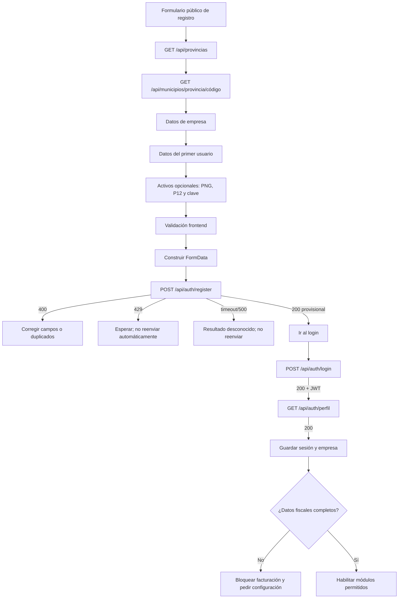
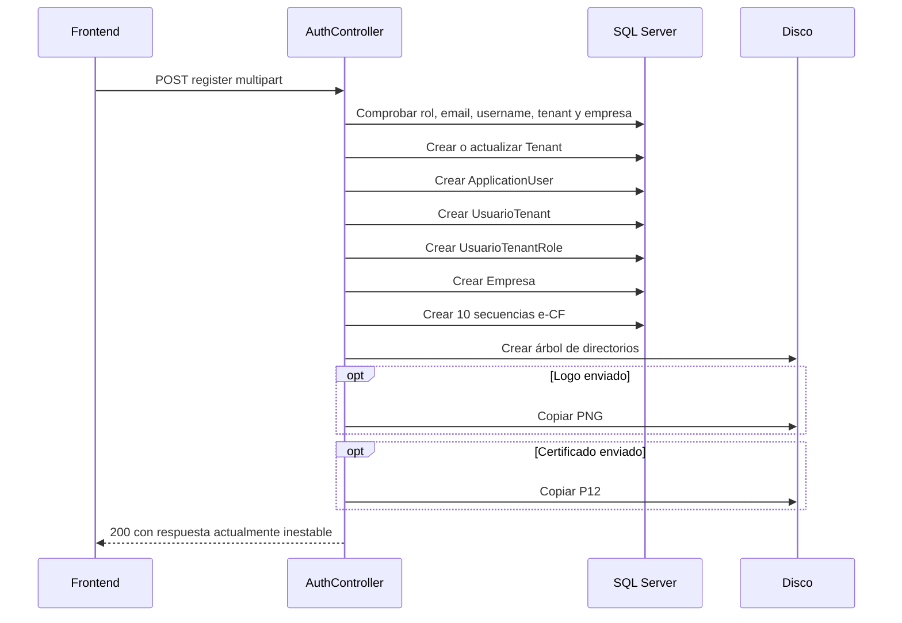

# Registro de empresa: integración end-to-end para frontend

Documento verificado el **20 de septiembre de 2026** contra `origin/main` del proyecto **EffisortEmisionEcf** (`3db84ed`). Los dos commits remotos más recientes modifican correo electrónico, pero no cambian el contrato de registro descrito aquí.

Esta guía cubre el alta pública de una empresa, su primer usuario administrador y la transición hacia login, perfil y preparación fiscal. Para el resto de la API consultar [`README.md`](./README.md) y [`api-types.ts`](./api-types.ts).

## 1. Resumen ejecutivo

| Aspecto | Contrato vigente |
|---|---|
| Endpoint | `POST /api/auth/register` |
| Seguridad | Público; no enviar Bearer |
| Entrada | `multipart/form-data` |
| DTO backend | `RegisterDto` |
| Código de éxito | `200` |
| JWT | No se devuelve; el login es un paso separado |
| Archivos | Logo PNG y certificado P12 opcionales |
| Operación | Varias escrituras SQL y operaciones de disco |
| Transacción única | No existe |
| Idempotencia | No existe |
| Reintento automático | Prohibido |
| Respuesta de éxito | Inestable actualmente por falta de `await` |

El endpoint no crea únicamente una fila `Empresa`. También crea o reutiliza el tenant, inserta el usuario de Identity, relaciona usuario/tenant/rol, crea la empresa, registra diez rangos de e-CF, crea directorios y opcionalmente copia archivos.

El alta de cuenta y la preparación para facturar son estados diferentes. Una empresa recién registrada no tiene dirección fiscal porque el DTO no la solicita; además, certificado y clave son opcionales. El frontend debe permitir iniciar sesión después del alta, pero no debe asumir que la empresa ya está lista para emitir e-CF.

## 2. Flujo completo



### Estados recomendados de la UI

| Estado | Condición | Acción disponible |
|---|---|---|
| `draft` | Formulario incompleto | Editar |
| `validating` | Validación local | Esperar |
| `submitting` | POST en curso | Bloquear formulario y doble clic |
| `validation_error` | `400` atribuible a campos | Corregir y reenviar manualmente |
| `provisional_success` | `200` | Ir al login; no consumir el body como contrato estable |
| `unknown_result` | Timeout, desconexión o `500` | Ir al login o soporte; no repetir el registro |
| `authenticated` | Login y perfil correctos | Entrar a la aplicación |
| `fiscal_setup_required` | Perfil sin datos necesarios para emitir | Bloquear facturación |

## 3. Datos previos y pantallas

### 3.1 Ubicación

Los códigos se cargan desde:

```http
GET /api/provincias
GET /api/municipios/provincia/{codigoProvincia}
```

Ambos son públicos. Enviar el `codigo` de seis caracteres, no el GUID del registro. Cuando cambie la provincia se debe limpiar el municipio seleccionado y recargar su catálogo.

Los contratos ya están declarados como `Provincia` y `Municipio` en [`api-types.ts`](./api-types.ts):

```ts
export interface Provincia {
  id: string;
  tenantId: string;
  codigo: string;
  nombre: string;
  activo: boolean;
}

export interface Municipio extends Provincia {
  provinciaCodigo: string;
}
```

Ejemplos de respuesta:

```json
[
  {
    "id": "195aebbb-e603-4717-9e6c-6f16748663d7",
    "tenantId": "90dfad08-5c55-43c3-8fd4-d5d3af8003f4",
    "codigo": "010000",
    "nombre": "Distrito Nacional",
    "activo": true
  }
]
```

```json
[
  {
    "id": "aed5143c-0644-461c-969e-70d165a480df",
    "tenantId": "90dfad08-5c55-43c3-8fd4-d5d3af8003f4",
    "codigo": "010100",
    "nombre": "Santo Domingo de Guzmán",
    "provinciaCodigo": "010000",
    "activo": true
  }
]
```

Mostrar solamente registros con `activo === true`. `id` y `tenantId` son metadatos del catálogo: no deben enviarse como `ProvinciaId` o `MunicipioId`. La respuesta no viene envuelta en `data`; es un arreglo JSON directo.

La consulta automática de RNC no está disponible: `DgiiController` está excluido del build. El usuario debe escribir los datos de la empresa manualmente.

### 3.2 Pasos sugeridos del formulario

1. **Empresa:** RNC, razón social, actividad económica, provincia y municipio.
2. **Administrador:** nombre completo, teléfono, username, email y confirmaciones.
3. **Configuración fiscal opcional:** logo, certificado y clave del certificado.
4. **Confirmación:** resumen sin mostrar contraseñas ni clave del certificado.

No existe verificación de email posterior al registro; el usuario se crea con `EmailConfirmed = true`.

## 4. DTO de frontend

Usar `RegisterForm` de [`api-types.ts`](./api-types.ts):

```ts
export interface RegisterForm {
  rnc: string;
  razonSocial: string;
  actividadEconomica: string;
  provinciaId: string;
  municipioId: string;
  fullName: string;
  phoneNumber: string;
  userName: string;
  email: string;
  confirmEmail: string;
  password: string;
  confirmPassword: string;
  logoEmpresa?: File | null;
  certificadoFirmaDigital?: File | null;
  passwordCertificadoFirmaDigital?: string;
}
```

La interfaz usa camelCase para el estado local. Al crear `FormData` deben utilizarse los nombres PascalCase exactos expuestos en `REGISTER_FORM_DATA_FIELDS`.

## 5. Campos y validaciones

| Campo multipart | Obligatorio | Backend declara | Regla práctica del frontend |
|---|---:|---|---|
| `Rnc` | Sí | Máximo 11 | `trim()`, 1–11 caracteres; no imponer otra regla fiscal sin decisión de producto |
| `RazonSocial` | Sí | Máximo 80 | Máximo **50**, porque se copia a columnas de Empresa de 50 |
| `ActividadEconomica` | Sí | Máximo 100 | `trim()`, máximo 100 |
| `ProvinciaId` | Sí | Longitud exacta 6 | Elegir del catálogo y enviar su código |
| `MunicipioId` | Sí | Longitud exacta 6 | Debe pertenecer a la provincia elegida |
| `FullName` | Sí | Sin longitud máxima en DTO | Solicitarlo, aunque el servicio vigente no lo persiste |
| `PhoneNumber` | Sí | Sin formato/máximo en DTO | Máximo **12**, porque termina en `Empresa.Telefono` |
| `UserName` | Sí | Mínimo 6 | `trim()`, mínimo 6; comprobar disponibilidad sólo mediante el POST |
| `Email` | Sí | Formato email | Máximo **80**, porque termina en `Empresa.Correo`; normalizar espacios/case |
| `ConfirmEmail` | Sí | Formato email | Comparar con `Email` en frontend; el backend no los compara |
| `Password` | Sí | Mínimo 6 | No recortar ni transformar; mostrar indicador de seguridad propio |
| `ConfirmPassword` | Sí | Mínimo 6 | Debe coincidir exactamente; el backend sí realiza esta comparación |
| `LogoEmpresa` | No | `IFormFile` | PNG con MIME exacto `image/png` |
| `CertificadoFirmaDigital` | No | `IFormFile` | P12 con MIME exacto `application/x-pkcs12` |
| `PasswordCertificadoFirmaDigital` | No | String | Si se adjunta P12, exigir clave; no persistirla en el navegador |

Las restricciones prácticas más cortas de razón social, teléfono y email evitan que el DTO pase la validación y luego falle al guardar `Empresa`.

El backend no define un máximo de archivo específico. El frontend puede aplicar un límite de producto, pero no debe documentarlo como límite de la API hasta acordarlo con backend.

### 5.1 Reglas de archivos

- No aceptar logo que no sea PNG.
- No aceptar certificado que no sea `.p12` y cuyo `File.type` no sea `application/x-pkcs12`.
- Algunos navegadores/sistemas pueden entregar otro MIME o uno vacío para P12. En ese caso, el registro actual puede responder `200` aunque el servidor no copie el certificado, porque el resultado de la copia se descarta.
- Si el objetivo es dejar la empresa lista para facturar, certificado y clave deben tratarse como una pareja obligatoria en frontend.
- Si se omite el certificado, no existe actualmente un endpoint público para cargarlo después.
- Si se omite el logo, la base de datos aun guarda `{RNC}.png`, aunque el archivo no exista.

## 6. Construcción de `FormData`

En navegador no se debe establecer manualmente `Content-Type`; `fetch` agrega el boundary correcto.

```ts
import {
  REGISTER_FORM_DATA_FIELDS as F,
  type RegisterForm,
} from "./api-types";

export function buildRegisterFormData(values: RegisterForm): FormData {
  const data = new FormData();

  data.append(F.rnc, values.rnc.trim());
  data.append(F.razonSocial, values.razonSocial.trim());
  data.append(F.actividadEconomica, values.actividadEconomica.trim());
  data.append(F.provinciaId, values.provinciaId);
  data.append(F.municipioId, values.municipioId);
  data.append(F.fullName, values.fullName.trim());
  data.append(F.phoneNumber, values.phoneNumber.trim());
  data.append(F.userName, values.userName.trim());
  data.append(F.email, values.email.trim().toLowerCase());
  data.append(F.confirmEmail, values.confirmEmail.trim().toLowerCase());
  data.append(F.password, values.password);
  data.append(F.confirmPassword, values.confirmPassword);

  if (values.passwordCertificadoFirmaDigital) {
    data.append(
      F.passwordCertificadoFirmaDigital,
      values.passwordCertificadoFirmaDigital,
    );
  }
  if (values.logoEmpresa) data.append(F.logoEmpresa, values.logoEmpresa);
  if (values.certificadoFirmaDigital) {
    data.append(F.certificadoFirmaDigital, values.certificadoFirmaDigital);
  }

  return data;
}
```

No convertir archivos a Base64 ni enviar JSON. Los ejemplos HTTP ejecutables están en [`examples/registro-empresa-solicitud.http`](./examples/registro-empresa-solicitud.http).

## 7. Solicitud HTTP

```ts
export async function registrarEmpresa(
  apiUrl: string,
  values: RegisterForm,
  signal?: AbortSignal,
): Promise<{ status: number; body: unknown }> {
  const response = await fetch(`${apiUrl}/api/auth/register`, {
    method: "POST",
    headers: { Accept: "application/json" },
    body: buildRegisterFormData(values),
    signal,
  });

  const text = await response.text();
  const contentType = response.headers.get("content-type") ?? "";
  let body: unknown = text;

  if (text && contentType.includes("json")) {
    try {
      body = JSON.parse(text);
    } catch {
      body = text;
    }
  }

  if (!response.ok) {
    throw new RegisterHttpError(response.status, body);
  }

  return { status: response.status, body };
}

export class RegisterHttpError extends Error {
  constructor(
    public readonly status: number,
    public readonly body: unknown,
  ) {
    super(`No se pudo registrar la empresa (${status})`);
  }
}
```

No agregar retry al cliente HTTP para esta función. Un `AbortController` debe usarse sólo para desmontaje/control explícito, entendiendo que abortar en el navegador no revierte cambios ya iniciados en el servidor.

## 8. Respuestas

### 8.1 Validación automática: `400`

Por `[ApiController]`, errores de anotaciones suelen responder `ValidationProblemDetails`:

```json
{
  "type": "https://tools.ietf.org/html/rfc9110#section-15.5.1",
  "title": "One or more validation errors occurred.",
  "status": 400,
  "errors": {
    "Rnc": ["El RNC es obligatorio"],
    "ProvinciaId": ["La longitud debe ser de 6 posiciones."]
  },
  "traceId": "..."
}
```

Mapear las claves PascalCase a los campos camelCase. Si una clave no se reconoce, mostrarla en un resumen general.

### 8.2 Reglas de negocio: `400` texto

Mensajes posibles:

```text
❌ - Exite un problema con la definición de roles por defectode la cuenta.
❌ - Este [Email] se encuentra actualmente en uso.
❌ - Este [UserName] se encuentra actualmente en uso.
❌ - Esta empresa se encuentra actualmente registrada.
❌ - Las contraseñas no coinciden.
```

Mapeo sugerido:

| Contenido | Campo/área |
|---|---|
| `[Email]` | `email` |
| `[UserName]` | `userName` |
| `empresa` | `rnc` y resumen general |
| `contraseñas` | `confirmPassword` |
| `roles` | Error general de configuración |

El controlador construye también un `BadRequest` para tenant duplicado, pero no lo retorna. En el caso normal, la verificación posterior de empresa duplicada sí corta el flujo. En un estado parcial donde exista tenant pero no empresa, el servicio puede reutilizar y actualizar ese tenant.

### 8.3 Resultado de negocio pretendido

El servicio intenta producir este JSON:

```json
{
  "id": "c88c7491-9875-4bc2-8977-23c932b98242",
  "userName": "adalovelace",
  "email": "ada@empresa.com",
  "password": "Secreto123",
  "message": "Empresa registrada exitosamente"
}
```

Está disponible en [`examples/registro-empresa-respuesta-esperada.json`](./examples/registro-empresa-respuesta-esperada.json), pero **no debe tratarse como contrato HTTP estable**.

### 8.4 Defecto actual de la respuesta `200`

El controlador ejecuta:

```csharp
return Ok(_authService.Registrar(model));
```

Falta `await`. Por tanto, entrega un `Task` al serializador en lugar del resultado de negocio. El payload real puede no tener la forma anterior y la respuesta puede completarse mientras el trabajo continúa o falla. En TypeScript, `RegisterResponse` permanece como `unknown`.

Reglas frontend mientras exista este defecto:

- Considerar `200` un éxito **provisional**.
- No leer `id`, `message` ni cualquier otra propiedad para tomar decisiones críticas.
- Nunca guardar ni mostrar `password` si apareciera.
- Limpiar del estado los passwords y archivos al abandonar la pantalla.
- Navegar al login como verificación independiente.
- Si el login falla, no repetir automáticamente el registro; ofrecer reintento manual de login y soporte.

### 8.5 Otros resultados

| Resultado | Tratamiento frontend |
|---|---|
| `401/403` | No son esperados en registro; mostrar error general, sin crear sesión |
| `413` | Archivo/request rechazado por infraestructura; conservar campos no sensibles |
| `415` | Se envió un tipo de contenido incorrecto; revisar que sea `FormData` |
| `429` texto | Esperar; no reenviar automáticamente |
| Timeout/desconexión | Resultado desconocido; no reenviar |
| `500` o conexión cerrada | Puede existir alta parcial; enviar al login o soporte |

## 9. Trabajo realizado por el backend

No existe una transacción que abarque todo el flujo. Cada etapa llama `SaveChangesAsync` por separado.



### 9.1 Entidades y valores derivados

| Recurso | Valores principales |
|---|---|
| `Tenant` | Código = RNC, nombre = razón social, dominio `https://effisort.com/{RNC}/`, activo |
| `ApplicationUser` | Email/username, `DisplayName = RazonSocial`, tenant, email confirmado, activo |
| `UsuarioTenant` | Usuario/tenant, `IsAdmin = true`, activo |
| `UsuarioTenantRole` | Rol configurado en `DefaultRoleForRegister` |
| `Empresa` | Razón/nombre comercial, RNC, ubicación, correo, teléfono, actividad y defaults fiscales |
| Secuencias | E31, E32, E33, E34, E41, E43, E44, E45, E46 y E47 |
| Directorios | Certificados, logos, entradas/salidas, acuses, aprobaciones y carpetas por tipo e-CF |

Las secuencias se crean con plantilla de diez ceros, rango `1–50`, última secuencia `0`, activas y vencimiento al 31 de diciembre del año actual + 2. Esto no demuestra que el tenant tenga rangos autorizados para producción.

### 9.2 Valores por defecto de `Empresa`

| Propiedad | Valor inicial |
|---|---|
| `NombreComercial` | `RazonSocial` |
| `NombreRazonSocial` | `RazonSocial` |
| `Sucursal` | `"Principal"` |
| `Correo` | `Email` |
| `Telefono` | `PhoneNumber` |
| `AmbienteTrabajo` | `"TesteCF"` |
| `IndicadorEnvioDiferido` | `false` |
| `IndicadorMontoGravado` | `false` |
| `AgregarValorPagar` | `false` |
| `DocumentoFiscalRequiereFormaPago` | `false` |
| `AgregarSubtotalInformativo` | `false` |
| `MostrarSoloProductosActivos` | `true` |
| `IngresarDescuentoPorMonto` | `true` |
| `IngresarRecargoPorMonto` | `true` |
| `LogoEmpresa` | `{RNC}.png`, incluso si no se adjuntó logo |
| `ArchivoCertificado` | Nombre original del P12 o string vacío |
| `PasswordCertificado` | Clave recibida o string vacío |

## 10. Diferencias importantes entre lo capturado y lo persistido

- `FullName` es obligatorio, pero no se utiliza al crear el usuario.
- `ApplicationUser.DisplayName` recibe la razón social, no `FullName`.
- `PhoneNumber` se guarda como `Empresa.Telefono`; no se asigna a `ApplicationUser.PhoneNumber`. Por eso `/api/auth/perfil` puede devolver `phoneNumber: null` aunque se haya capturado teléfono.
- `ConfirmEmail` se valida como email, pero el backend no comprueba que coincida con `Email`.
- La clave del certificado se almacena en la empresa; el frontend no debe conservarla ni intentar recuperarla.
- El resultado de copiar logo/certificado se ignora, por lo que un archivo inválido puede no impedir un `200`.
- El rol se inserta en `UsuariosTenantsRoles`, pero el login obtiene roles desde `AspNetUserRoles`. El JWT inicial puede no contener claims `role`.

## 11. Después del registro

### 11.1 Login

El registro no devuelve token. El usuario debe autenticarse por separado:

```http
POST /api/auth/login
Content-Type: application/json

{
  "email": "ada@empresa.com",
  "password": "Secreto123"
}
```

Un login correcto devuelve `{ "token": "..." }`. Validar que el JWT contenga un `Tenant_ID` no vacío.

### 11.2 Perfil

Con el JWT:

```http
GET /api/auth/perfil
Authorization: Bearer <token>
```

Guardar `UsuarioPerfil` en el store de sesión. El nodo `empresa` confirma el tenant, RNC, ubicación, correo y actividad que quedaron persistidos.

### 11.3 Preparación fiscal

Antes de habilitar facturación, verificar al menos:

- RNC, razón social y dirección fiscal.
- Provincia y municipio.
- Certificado y contraseña configurados en backend.
- Ambiente DGII correcto.
- Secuencias autorizadas/configuradas.
- Configuración DGII y XSD operativa.

El registro actual nunca captura `Direccion`, por lo que `perfil.empresa.direccion` queda normalmente `null`. Tampoco existe un endpoint de actualización de empresa o carga posterior de certificado. La UI debe mostrar “configuración fiscal pendiente” y bloquear emisión hasta que esos datos sean provisionados por un proceso backend/administrativo.

No usar las rutas públicas `/api/empresas/{id}` o `/api/empresas/rnc/{rnc}` para completar este flujo: devuelven la entidad con secretos y no son una alternativa segura a un endpoint de onboarding.

## 12. Recuperación ante fallos y duplicados

Debido a las escrituras parciales, después de timeout o `500` pueden existir tenant, usuario o empresa aunque el navegador no haya recibido éxito.

Flujo seguro:

1. No reenviar automáticamente el POST.
2. Permitir al usuario intentar el login con el email/password capturados.
3. Si entra, cargar perfil y continuar como alta completada o configuración pendiente.
4. Si el login no funciona y un reintento manual de registro devuelve duplicado, mostrar un canal de soporte/recuperación; no cambiar silenciosamente RNC, email o username.
5. No usar `forgot-password` como prueba de existencia automática, porque expone mensajes distintos para usuario inexistente.

El frontend debe conservar únicamente los campos no sensibles necesarios para que el usuario no los reescriba. No persistir passwords, clave P12 ni contenido de archivos en `localStorage`, logs, analytics o herramientas de monitoreo.

## 13. Dependencias operativas del backend

Aunque el usuario complete correctamente el formulario, el alta puede fallar si:

- `DefaultRoleForRegister` no existe.
- El ID del rol no puede convertirse a GUID.
- La base de datos o algún índice único rechaza una escritura.
- Faltan las configuraciones globales de directorios.
- El proceso no tiene permisos de escritura en disco.
- El árbol del tenant no puede crearse.
- El servidor se detiene entre dos `SaveChangesAsync`.

Estos errores no son corregibles desde el formulario. Mostrar un mensaje general y conservar el `traceId` cuando exista, sin enseñar stack traces ni detalles internos.

## 14. Seguridad y privacidad frontend

- Usar HTTPS fuera de desarrollo.
- No enviar Bearer al endpoint público de registro.
- No registrar el objeto `RegisterForm`, `FormData`, passwords ni archivos.
- No guardar el P12 o su clave en almacenamiento persistente del navegador.
- Ocultar la clave del certificado y permitir mostrarla sólo mediante acción explícita.
- Deshabilitar el botón durante `submitting`.
- No incluir datos sensibles en query strings.
- Limpiar credenciales y referencias a archivos después del flujo.
- No confiar en el MIME como validación de contenido; es sólo la condición actual que aplica el backend.

## 15. Pruebas mínimas del frontend

### Unitarias

- Mapeo camelCase → nombres PascalCase de `FormData`.
- Los doce campos de texto obligatorios se agregan exactamente una vez.
- Logo/certificado sólo se agregan cuando existen.
- No se establece manualmente `Content-Type`.
- Email/confirmación y password/confirmación deben coincidir.
- Provincia/municipio tienen seis caracteres.
- Razón social respeta el máximo práctico de 50.
- Teléfono máximo 12 y email máximo 80.
- Certificado exige clave en modo de preparación fiscal.
- Mapeo de `ValidationProblemDetails.errors` a campos.

### Integración

- Registro sin archivos.
- Registro con PNG y P12 válidos.
- Email duplicado.
- Username duplicado.
- Empresa/RNC duplicado.
- Rol por defecto ausente.
- Archivo con MIME incorrecto, dejando visible la limitación de que el backend puede responder éxito.
- `429` sin retry.
- Timeout/`500` produce `unknown_result`.
- Doble clic produce una sola petición.
- Después de `200`, se navega a login sin depender del body.
- Login → perfil → detección de configuración fiscal pendiente.

### E2E

```text
Provincia → municipio → completar empresa/usuario → adjuntar activos opcionales
→ revisar → enviar una vez → login → perfil → dashboard
→ facturación bloqueada si dirección/certificado/configuración no están listos
```

## 16. Criterios de aceptación

- [ ] El formulario utiliza `RegisterForm` y `REGISTER_FORM_DATA_FIELDS`.
- [ ] La petición es multipart y el navegador genera el boundary.
- [ ] La validación refleja tanto el DTO como los límites prácticos de `Empresa`.
- [ ] ConfirmEmail se compara localmente.
- [ ] Certificado y clave se validan como pareja cuando se solicita preparación fiscal.
- [ ] Existe estado de loading y bloqueo de doble submit.
- [ ] No existe retry automático.
- [ ] Se soportan errores JSON, texto, vacío, timeout y `429`.
- [ ] La respuesta `200` se trata como provisional y `unknown`.
- [ ] El registro nunca crea una sesión directamente.
- [ ] Login y perfil verifican el resultado real del alta.
- [ ] La UI diferencia cuenta creada de empresa lista para facturar.
- [ ] La facturación queda bloqueada mientras falte configuración fiscal.
- [ ] Ningún secreto aparece en logs, analytics o almacenamiento persistente.

## 17. Bloqueos que requieren backend

El frontend no puede resolver por sí solo:

1. Agregar `await` a `Registrar` y definir una respuesta estable que no incluya password.
2. Ejecutar todo el registro en una transacción o implementar compensación.
3. Retornar y validar los resultados de copia de logo/certificado.
4. Comparar `Email` con `ConfirmEmail` también en servidor.
5. Persistir `FullName` y `PhoneNumber` en el usuario si ese es el comportamiento deseado.
6. Asignar el rol en `AspNetUserRoles` para que aparezca en el JWT.
7. Crear endpoints seguros para completar dirección, certificado y configuración fiscal.
8. Proveer un estado explícito de “empresa lista para facturar”.
9. Evitar almacenar o exponer secretos de certificado sin protección adecuada.
10. Corregir el `BadRequest` de tenant duplicado que se construye pero no se retorna.
