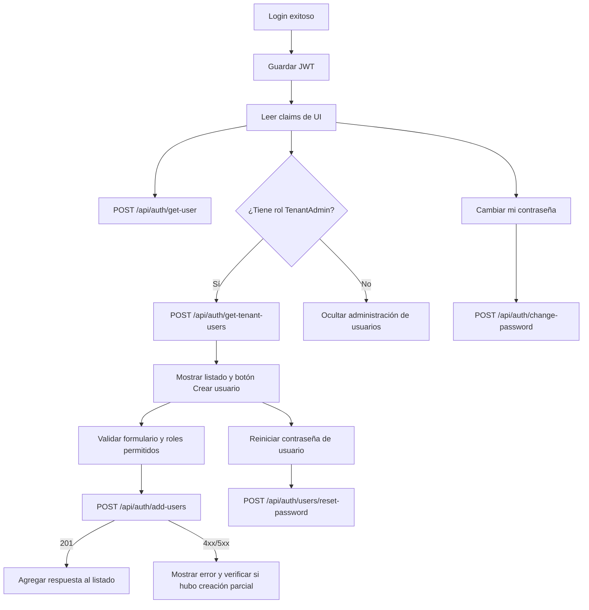

# Gestión de usuarios del tenant: integración para frontend

Documento verificado el **11 de octubre de 2026** contra `origin/main` de **EffisortEmisionEcf** (`a3dd471`). Cubre los endpoints de usuarios incorporados en `AuthController`. Los contratos TypeScript están en [`api-types.ts`](./api-types.ts) y las solicitudes manuales en [`examples/usuarios-tenant.http`](./examples/usuarios-tenant.http).

## 1. Alcance y modelo de permisos

Los usuarios pertenecen a un tenant. El frontend nunca envía `tenantId` ni el ID del usuario autenticado: el backend los obtiene desde las claims JWT `Tenant_ID` y `nameid`.

| Operación | Ruta | Autorización efectiva | Resultado |
|---|---|---|---|
| Ver usuario actual | `POST /api/auth/get-user` | JWT requerido en la práctica | Un `TenantUser` o `null` |
| Listar usuarios | `POST /api/auth/get-tenant-users` | JWT con rol `TenantAdmin` | `TenantUser[]` del tenant actual |
| Crear usuario | `POST /api/auth/add-users` | JWT con rol `TenantAdmin` | `201 Created` y `TenantUser` |
| Cambiar contraseña propia | `POST /api/auth/change-password` | JWT | `200` con mensaje |
| Reiniciar contraseña de otro usuario | `POST /api/auth/users/reset-password` | JWT con rol `TenantAdmin` | `200` con mensaje |

Todos consumen JSON y requieren `Authorization: Bearer <token>`. Aunque `get-user` no tiene el atributo `[Authorize]` en el controlador, internamente lee claims obligatorias y falla sin token. Tratarlo como una ruta protegida hasta que backend agregue el atributo.

Los roles en el token usan el tipo de claim estándar de ASP.NET (`ClaimTypes.Role`). El frontend debe leerlos sólo para ocultar o mostrar acciones; la API decide el permiso final.

## 2. Flujo completo



Estados de pantalla recomendados:

| Estado | Uso |
|---|---|
| `loading` | Carga del usuario actual o listado |
| `forbidden` | El token no tiene `TenantAdmin` o el API responde `403` |
| `ready` | Listado y acciones disponibles |
| `creating` | Bloquear doble clic al crear usuario |
| `resettingPassword` | Confirmación y envío de reinicio administrativo |
| `changingOwnPassword` | Cambio de contraseña del usuario actual |
| `unknownResult` | Timeout o `5xx` después de crear/reiniciar; no repetir automáticamente |

## 3. DTOs de frontend

Importar los contratos desde [`api-types.ts`](./api-types.ts):

```ts
export interface TenantUser {
  id: string;
  tenantId: string;
  userName: string;
  email: string;
  displayName: string;
  roles: string[];
}

export interface CreateTenantUserRequest {
  firstName: string;
  lastName: string;
  email: string;
  userName: string;
  password: string;
  roles: TenantUserRole[];
}

export interface ChangePasswordRequest {
  currentPassword: string;
  newPassword: string;
}

export interface ResetTenantUserPasswordRequest {
  userId: string;
  newPassword: string;
}
```

La API serializa propiedades en `camelCase`. Para crear un usuario, enviar el body JSON directamente; no usar `multipart/form-data` ni envolverlo en `data`.

## 4. Roles permitidos al crear

El backend acepta únicamente los siguientes valores. La comparación ignora mayúsculas/minúsculas, pero enviar los literales exactos evita respuestas inconsistentes y hace el contrato legible.

```ts
export const TENANT_USER_ROLES = [
  "TenantAdmin", "TenantUser", "Manager", "Operator",
  "InvUser", "InvManager", "InvOperator",
  "CxcUser", "CxcManager", "CxcOperator",
  "CxpUser", "CxpManager", "CxpOperator",
  "FacUser", "FacManager", "FacOperator",
  "CntUser", "CntManager", "CntOperator",
] as const;
```

| Grupo | Roles |
|---|---|
| Administración general | `TenantAdmin`, `TenantUser`, `Manager`, `Operator` |
| Inventario | `InvUser`, `InvManager`, `InvOperator` |
| Cuentas por cobrar | `CxcUser`, `CxcManager`, `CxcOperator` |
| Cuentas por pagar | `CxpUser`, `CxpManager`, `CxpOperator` |
| Facturación | `FacUser`, `FacManager`, `FacOperator` |
| Contabilidad | `CntUser`, `CntManager`, `CntOperator` |

No ofrecer `SuperAdmin`. Tampoco ofrecer `PrdUser`, `PrdManager` ni `PrdOperator`: en la implementación actual esos tres valores están definidos accidentalmente como roles de cuentas por cobrar y terminan duplicados. No hay un endpoint para obtener la lista de roles disponibles; mantener esta lista centralizada en el frontend hasta que backend exponga un catálogo autorizado.

El servicio elimina de forma silenciosa cualquier rol fuera de esta lista. Por ejemplo, si se envía `roles: ["FacUser", "NoExiste"]`, el usuario puede crearse sólo con `FacUser`; si se envían únicamente roles no permitidos, se crea sin roles. Por eso el selector debe ser cerrado y no aceptar texto libre.

## 5. Consultar el usuario actual

```http
POST /api/auth/get-user
Authorization: Bearer <token>
```

No lleva body. Si existe un usuario con el `nameid` y `Tenant_ID` del token, responde `200`:

```json
{
  "id": "a8c931c5-3b39-4a5e-80d7-67942972b748",
  "tenantId": "b0d2310a-5ae5-4cc7-87c3-2e12b0487b29",
  "userName": "maria.ventas",
  "email": "maria@empresa.com",
  "displayName": "María Pérez",
  "roles": ["FacUser"]
}
```

Si la búsqueda no encuentra el usuario, el controlador devuelve `200` con `null`, no `404`. Cerrar sesión y solicitar login nuevamente si el token sigue presente pero este endpoint devuelve `null`.

## 6. Listar usuarios del tenant

```http
POST /api/auth/get-tenant-users
Authorization: Bearer <token de TenantAdmin>
```

No lleva body y responde un arreglo JSON, incluso si está vacío:

```json
[
  {
    "id": "a8c931c5-3b39-4a5e-80d7-67942972b748",
    "tenantId": "b0d2310a-5ae5-4cc7-87c3-2e12b0487b29",
    "userName": "maria.ventas",
    "email": "maria@empresa.com",
    "displayName": "María Pérez",
    "roles": ["FacUser"]
  }
]
```

El listado se filtra por `Tenant_ID` del token. No hay paginación, filtros, orden garantizado, detalle por ID ni actualización/desactivación de usuario. El frontend debe evitar simular esas capacidades con datos locales.

## 7. Crear usuario

```http
POST /api/auth/add-users
Authorization: Bearer <token de TenantAdmin>
Content-Type: application/json

{
  "firstName": "María",
  "lastName": "Pérez",
  "email": "maria@empresa.com",
  "userName": "maria.ventas",
  "password": "ClaveSegura1!",
  "roles": ["FacUser"]
}
```

En éxito responde `201 Created` con el usuario creado:

```json
{
  "id": "a8c931c5-3b39-4a5e-80d7-67942972b748",
  "tenantId": "b0d2310a-5ae5-4cc7-87c3-2e12b0487b29",
  "userName": "maria.ventas",
  "email": "maria@empresa.com",
  "displayName": "María Pérez",
  "roles": ["FacUser"]
}
```

El backend recorta `firstName`, `lastName` y `userName`; convierte `email` a minúsculas. `displayName` se forma como `firstName + " " + lastName`. El `tenantId` siempre viene del token administrador. El usuario queda con `EmailConfirmed = true` y activo por defecto.

### 7.1 Validación que debe hacer el frontend

Los DTOs no tienen atributos de validación. Los valores deben tratarse como obligatorios en la UI porque el servicio llama `Trim()` sobre nombre, apellido, email y username. Un campo omitido o `null` puede terminar como `500`.

La creación usa las opciones por defecto de ASP.NET Identity porque no hay una configuración personalizada en `Program.cs`. En la práctica, validar antes de enviar:

| Campo | Regla de frontend |
|---|---|
| `firstName`, `lastName` | Requeridos después de `trim()` |
| `email` | Requerido, formato email y normalizar a minúsculas |
| `userName` | Requerido; usar caracteres admitidos por Identity (`a-z`, `A-Z`, números, `-._@+`) |
| `password` | Mínimo 6, al menos una mayúscula, minúscula, dígito y carácter no alfanumérico |
| `roles` | Arreglo; validar cada valor contra `TENANT_USER_ROLES` |

Email y username son únicos a nivel global de Identity, no sólo dentro del tenant. Si otro tenant ya los usa, no se podrá crear el usuario.

### 7.2 Errores y creación parcial

| Situación | Comportamiento observado | Tratamiento frontend |
|---|---|---|
| Email duplicado | `BusinessException` | Mostrar que el correo ya está en uso; el status/body puede ser `500` hasta que exista manejador global |
| Username duplicado | `BusinessException` | Mostrar que el username ya está en uso; el status/body puede ser `500` |
| Contraseña no cumple Identity | `BusinessException` con varios mensajes | Mapear texto si está disponible; conservar los campos no sensibles |
| Rol permitido no existe en base de datos | Se crea el usuario y luego se lanza excepción | Resultado desconocido; no reenviar automáticamente |
| Timeout o `5xx` | El usuario puede haberse creado | Recargar listado antes de ofrecer otro intento |

La creación no está envuelta en transacción. El usuario se guarda antes de validar la existencia de cada rol. Nunca implementar retry automático para `add-users`; después de una respuesta ambigua, volver a consultar `get-tenant-users` y buscar por email/username.

## 8. Cambio de contraseña propia

```http
POST /api/auth/change-password
Authorization: Bearer <token>
Content-Type: application/json

{
  "currentPassword": "ClaveAnterior1!",
  "newPassword": "ClaveNueva2!"
}
```

Respuesta exitosa:

```json
{ "message": "Contraseña actualizada correctamente." }
```

La ruta aplica a la identidad de `nameid` del token. No recibe ni debe recibir `userId`. El backend verifica la contraseña actual, aplica la política de Identity y actualiza el `SecurityStamp`.

El JWT existente no se invalida de inmediato porque su validación no consulta `SecurityStamp`; sigue siendo utilizable hasta su expiración configurada. Limpiar las contraseñas del formulario tras cualquier respuesta y permitir continuar con la sesión actual.

## 9. Reinicio de contraseña por administrador

```http
POST /api/auth/users/reset-password
Authorization: Bearer <token de TenantAdmin>
Content-Type: application/json

{
  "userId": "a8c931c5-3b39-4a5e-80d7-67942972b748",
  "newPassword": "Temporal3!"
}
```

Respuesta exitosa:

```json
{ "message": "Contraseña reiniciada correctamente." }
```

El backend comprueba que el usuario solicitado pertenezca al mismo tenant del administrador. Un ID de otro tenant produce una excepción de “Usuario no encontrado”; no revela datos de otros tenants. La contraseña debe cumplir la misma política de Identity del alta.

La API no envía email, no fuerza cambio de contraseña en el próximo login y no devuelve una contraseña temporal. Si el producto requiere esos pasos, deben resolverse fuera de este endpoint o agregarse en backend.

## 10. Implementación de cliente sugerida

```ts
import type {
  ChangePasswordRequest,
  CreateTenantUserRequest,
  ResetTenantUserPasswordRequest,
  SuccessMessageResponse,
  TenantUser,
} from "./api-types";

async function postJson<T>(
  apiUrl: string,
  path: string,
  token: string,
  body?: unknown,
): Promise<T> {
  const response = await fetch(`${apiUrl}${path}`, {
    method: "POST",
    headers: {
      Authorization: `Bearer ${token}`,
      Accept: "application/json",
      ...(body === undefined ? {} : { "Content-Type": "application/json" }),
    },
    ...(body === undefined ? {} : { body: JSON.stringify(body) }),
  });

  const text = await response.text();
  let payload: unknown = text;
  try {
    payload = text ? JSON.parse(text) : null;
  } catch {
    // Algunos errores del backend pueden ser texto o HTML.
  }

  if (!response.ok) {
    throw new Error(`HTTP ${response.status}: ${typeof payload === "string" ? payload : JSON.stringify(payload)}`);
  }
  return payload as T;
}

export const getCurrentUser = (apiUrl: string, token: string) =>
  postJson<TenantUser | null>(apiUrl, "/api/auth/get-user", token);

export const listTenantUsers = (apiUrl: string, token: string) =>
  postJson<TenantUser[]>(apiUrl, "/api/auth/get-tenant-users", token);

export const createTenantUser = (
  apiUrl: string,
  token: string,
  body: CreateTenantUserRequest,
) => postJson<TenantUser>(apiUrl, "/api/auth/add-users", token, body);

export const changeOwnPassword = (
  apiUrl: string,
  token: string,
  body: ChangePasswordRequest,
) => postJson<SuccessMessageResponse>(apiUrl, "/api/auth/change-password", token, body);

export const resetTenantUserPassword = (
  apiUrl: string,
  token: string,
  body: ResetTenantUserPasswordRequest,
) => postJson<SuccessMessageResponse>(apiUrl, "/api/auth/users/reset-password", token, body);
```

Después de crear, agregar la respuesta al listado o volver a cargarlo. Después de cambiar/reiniciar una contraseña, nunca conservar el valor enviado en estado persistente, logs, analytics o notificaciones.

## 11. Casos no cubiertos por la API

No existen rutas activas de frontend para editar nombre/email/username, cambiar roles, desactivar/reactivar, eliminar usuarios, obtener un usuario por ID o listar roles disponibles. Tampoco hay paginación ni búsqueda de usuarios.

El frontend debe deshabilitar esas acciones o indicar que requieren soporte administrativo; no debe llamar a los endpoints globales de `RolesController` como sustituto, ya que no forman parte del flujo aislado por tenant.

## 12. Checklist de integración

- [ ] Enviar Bearer en las cinco rutas.
- [ ] Mostrar gestión de usuarios sólo con claim `TenantAdmin`; tratar `403` como autoridad final del servidor.
- [ ] Usar los tipos `TenantUser`, `CreateTenantUserRequest` y `TenantUserRole`.
- [ ] Ofrecer sólo `TENANT_USER_ROLES` en el selector.
- [ ] Validar password de Identity antes de enviar.
- [ ] Bloquear doble envío de creación y reinicio.
- [ ] No reintentar automáticamente después de `5xx` o timeout en creación.
- [ ] Recargar el listado después de un resultado ambiguo.
- [ ] Tratar `get-user: null` como sesión inválida.
- [ ] Limpiar contraseñas de memoria tras enviar o cerrar el modal.
